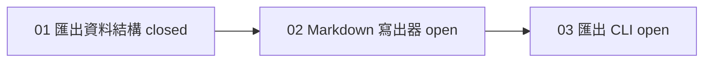

## 工具呼叫

- Skill {"skill": "pm"}
- Read {"file_path": "/private/var/folders/mp/2hbmdcp15qjfn3fhgctttgl40000gn/T/tmp.qzcGVeM0of/.claude/skills/pm/references/next-step.md"}
- Read {"file_path": "/private/var/folders/mp/2hbmdcp15qjfn3fhgctttgl40000gn/T/tmp.qzcGVeM0of/.claude/skills/pm/references/check.md"}
- Glob {"pattern": "**/*", "path": "/private/var/folders/mp/2hbmdcp15qjfn3fhgctttgl40000gn/T/tmp.qzcGVeM0of/.scratch/notes"}
- Read {"file_path": "/private/var/folders/mp/2hbmdcp15qjfn3fhgctttgl40000gn/T/tmp.qzcGVeM0of/.scratch/notes/spec.md"}
- Read {"file_path": "/private/var/folders/mp/2hbmdcp15qjfn3fhgctttgl40000gn/T/tmp.qzcGVeM0of/.scratch/notes/issues/01-export-schema.md"}
- Read {"file_path": "/private/var/folders/mp/2hbmdcp15qjfn3fhgctttgl40000gn/T/tmp.qzcGVeM0of/.scratch/notes/issues/02-markdown-writer.md"}
- Read {"file_path": "/private/var/folders/mp/2hbmdcp15qjfn3fhgctttgl40000gn/T/tmp.qzcGVeM0of/.scratch/notes/issues/03-export-cli.md"}
- Glob {"pattern": "**/*.md", "path": "/private/var/folders/mp/2hbmdcp15qjfn3fhgctttgl40000gn/T/tmp.qzcGVeM0of"}

## 最終回覆

**建議下一張：02 Markdown 寫出器。** 這次只讀取檔案，沒有執行任何工單，也沒有修改檔案。

**進度**（來源：`.scratch/notes/` 本地檔案，2026-10-20 讀取；分母是 3 張工單，沒有取消或範圍外的項目）：1/3 已關閉。

| 工單 | State | Blocked by | Assignee | 分類 |
| --- | --- | --- | --- | --- |
| 01 匯出資料結構 | closed | none | none | 完成 |
| 02 Markdown 寫出器 | open | 01 | none | **ready** |
| 03 匯出 CLI 指令 | open | 02 | none | 等待 02 |

**為什麼是 02：**
- 它的唯一前置 01 已關閉，也沒有其他阻塞，沒有人認領。
- 03 依賴 02，所以 02 是目前唯一的 ready 項目，也會解除 03。
- 這是線性鏈，沒有可平行的分支。

**01 的關閉證據：** 工單寫著 PR #11 已合併至 main，驗收項也已勾選。這個目錄不是 git repo，我沒辦法用 `gh` 核對 PR #11，所以合併狀態只來自工單文字，標為「未獨立驗證」。

**02 的交接內容：**
- **範圍：** 把匯出結構轉成 Markdown 檔。
- **驗收：** 單元測試涵蓋標題、清單、程式碼區塊。
- **前置：** 01 的匯出 JSON 結構，見 PR #11。
- **第一步：** 讀 01 定義的結構，再為三種區塊寫測試。

**進入點：沒有找到，需要你決定。**
- `AGENTS.md` 只規定「commit、push、merge 須使用者明確授權」，沒有宣告任何規劃或實作的進入點。
- spec 和工單裡也沒有指名進入點。
- 已安裝的 skill（`code-review`、`simplify` 等）都不是實作工單用的進入點，我不自行挑選。

請告訴我要用哪個流程處理 02。你指定後我會先讀取該進入點，再回覆「執行這張」，之後才會開始。就算開始，commit、push、merge 仍需你另外明確授權。
