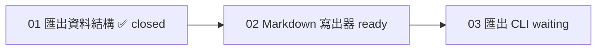

## 工具呼叫

- Skill {"skill": "pm"}
- Read {"file_path": "/private/var/folders/mp/2hbmdcp15qjfn3fhgctttgl40000gn/T/tmp.bayjIqKjve/.claude/skills/pm/references/next-step.md"}
- Read {"file_path": "/private/var/folders/mp/2hbmdcp15qjfn3fhgctttgl40000gn/T/tmp.bayjIqKjve/.claude/skills/pm/references/check.md"}
- Glob {"pattern": ".scratch/notes/**", "path": "/private/var/folders/mp/2hbmdcp15qjfn3fhgctttgl40000gn/T/tmp.bayjIqKjve"}
- Read {"file_path": "/private/var/folders/mp/2hbmdcp15qjfn3fhgctttgl40000gn/T/tmp.bayjIqKjve/.scratch/notes/spec.md"}
- Read {"file_path": "/private/var/folders/mp/2hbmdcp15qjfn3fhgctttgl40000gn/T/tmp.bayjIqKjve/.scratch/notes/issues/01-export-schema.md"}
- Read {"file_path": "/private/var/folders/mp/2hbmdcp15qjfn3fhgctttgl40000gn/T/tmp.bayjIqKjve/.scratch/notes/issues/02-markdown-writer.md"}
- Read {"file_path": "/private/var/folders/mp/2hbmdcp15qjfn3fhgctttgl40000gn/T/tmp.bayjIqKjve/.scratch/notes/issues/03-export-cli.md"}
- Glob {"pattern": ".claude/skills/**/SKILL.md", "path": "/private/var/folders/mp/2hbmdcp15qjfn3fhgctttgl40000gn/T/tmp.bayjIqKjve"}
- Read {"file_path": "/private/var/folders/mp/2hbmdcp15qjfn3fhgctttgl40000gn/T/tmp.bayjIqKjve/.claude/skills/ticket-runner/SKILL.md"}
- Glob {"pattern": "docs/workflow/*", "path": "/private/var/folders/mp/2hbmdcp15qjfn3fhgctttgl40000gn/T/tmp.bayjIqKjve"}

## 最終回覆

**建議下一張：工單 02「Markdown 寫出器」**(`.scratch/notes/issues/02-markdown-writer.md`)

**整體進度**(讀取自 `.scratch/notes/`,本地檔案,剛查詢):3 張工單中 1 張已完成,分母為 3,沒有取消或範圍外的項目。

| 工單 | 狀態 | 判斷依據 |
|---|---|---|
| 01 匯出資料結構 | closed | 驗收已勾選,PR #11 已合併至 main。PR 是工單檔自己寫的,我沒有用 `gh` 另外查證。 |
| 02 Markdown 寫出器 | open,**ready** | 只被 01 擋住,而 01 已完成。沒有指派人,不會重複開工。 |
| 03 匯出 CLI 指令 | open,等待 | 被 02 擋住,要等 02 完成。 |

**為什麼選 02:**
- 它是唯一的 ready 工單。
- 這個計畫是線性的,完成 02 才能解鎖 03。
- 目前沒有進行中的工作,也沒有發現循環依賴、缺少的節點或互相矛盾的狀態。

**交接內容:**
- **範圍:** 把匯出結構(01 定義的 JSON)轉成 Markdown 檔。
- **驗收:** 單元測試涵蓋標題、清單、程式碼區塊。
- **第一步:** 讀 01 定義的 JSON 結構,先寫涵蓋這三種區塊的失敗測試,再實作。
- **入口:** 專案內沒有 `implement` 或 `implement-spec`,只有 `ticket-runner`(單張工單、先寫測試)。這個計畫只有三張工單,而且我要處理的是單張,所以建議用 `ticket-runner`。
- **流程:** 依 `AGENTS.md`,實作要照 `docs/workflow/build-ticket.md`。
- **授權:** commit、push、merge 都需要你明確授權。

**限制:**
- 這次是唯讀模擬,我沒有載入也沒有啟動 `ticket-runner`,也沒有改任何檔案。
- 如果要繼續,請回覆「執行這張」。我接下來會讀 `docs/workflow/build-ticket.md`,再以 `ticket-runner` 實作工單 02,做完就停,不會自動接著做 03。
