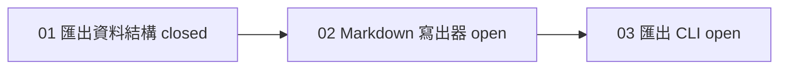

## 工具呼叫

- Skill {"skill": "pm"}
- Read {"file_path": "<tmp>/.claude/skills/pm/references/report.md"}
- Glob {"pattern": ".scratch/notes/**/*", "path": "<tmp>"}
- Read {"file_path": "<tmp>/.claude/skills/pm/references/check.md"}
- Read {"file_path": "<tmp>/.scratch/notes/spec.md"}
- Read {"file_path": "<tmp>/.scratch/notes/issues/01-export-schema.md"}
- Read {"file_path": "<tmp>/.scratch/notes/issues/02-markdown-writer.md"}
- Read {"file_path": "<tmp>/.scratch/notes/issues/03-export-cli.md"}

## 最終回覆

# inkwell 匯出計畫進度報告

**資料來源與時間**:讀取 `.scratch/notes/spec.md` 與 `issues/01~03`,查詢時間 2026-10-20。這個目錄不是 git repo,我也沒有查 PR 或遠端 tracker,所以 PR 狀態只能採用工單內的記載,沒有獨立核實。

## 整體進度

**1 / 3 張工單已關閉(約 33%)**。分母是計畫內全部 3 張工單,沒有取消或排除的項目。這個比例只代表工單數量,不代表功能完成度。

整體驗收「使用者可用 `inkwell export <路徑>` 匯出 Markdown」尚未達成,交付終點「所有 PR 合併至 main」也尚未達成。

## 各工單狀態

| 工單 | 來源狀態 | 依賴 | 負責人 | 判斷 |
| --- | --- | --- | --- | --- |
| 01 匯出資料結構 | closed | 無 | 未記載 | 完成。驗收項已勾選,記載 PR #11 已合併至 main(未獨立核實)。 |
| 02 Markdown 寫出器 | open | 01 | 無 | **就緒(ready frontier)**,但有一項待決會影響範圍,見下。 |
| 03 匯出 CLI | open | 02 | 無 | 等待 02,目前不能開始。 |

## 待決事項

1. **Markdown 輸出是否支援表格**
   - 決定者:產品負責人 Dana(來源:02 的 Comments)。
   - 影響:02 的範圍,以及 03 的輸出格式。
   - 02 在技術上已就緒,但範圍未定。我建議先請 Dana 決定再開工,避免返工。03 也受同一件事影響。

## 行動項目

- **AI-1**(owner: Carl):把測試指令補進 AGENTS.md。
  - 在 spec.md 的狀態是 open。
  - AGENTS.md 現在已有「## 測試:測試指令:`npm test`」,所以實質上**看起來已完成**。這是我的推論,依據是 AGENTS.md 的內容,不是 tracker 紀錄。
  - spec.md 的狀態尚未更新。建議 Carl 確認後改成 done。這次是唯讀,我沒有改。

## 風險與缺口

- 沒有核實 PR #11 的合併狀態,也沒有檢查是否有其他 PR 對應 02 或 03。
- 02 和 03 都沒有負責人。
- 沒有發現依賴循環、缺漏節點或狀態矛盾。

## 建議下一步

1. 請 Dana 決定表格支援。
2. 決定後,02 是下一張要做的工單。依 AGENTS.md,實作走 `docs/workflow/build-ticket.md`,且 commit、push、merge 都須你明確授權。
3. 02 完成後才輪到 03。

## 若你要我寫入(目前沒有寫入任何東西)

- 預設只在對話中交付這份報告,沒有建立檔案,也沒有對外發送。
- 若你要記錄行動項目,我會在 `.scratch/notes/spec.md` 的 `## Comments` 做兩件事:
  - 把 AI-1 更新為「done(AGENTS.md 已含 `npm test`)」。
  - 新增一項「待決:表格支援,Dana,影響 02、03」。
- 這些都要等你同意才會寫。
