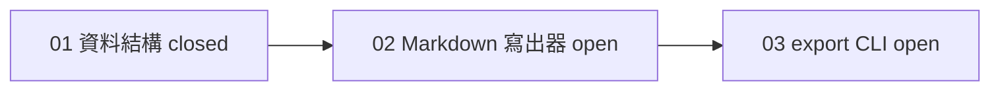

## 工具呼叫

- Skill {"skill": "pm"}
- Read {"file_path": "<tmp>/.claude/skills/pm/references/check.md"}
- Read {"file_path": "<tmp>/.claude/skills/pm/references/report.md"}
- Glob {"pattern": ".scratch/notes/**/*", "path": "<tmp>"}
- Read {"file_path": "<tmp>/.scratch/notes/spec.md"}
- Read {"file_path": "<tmp>/.scratch/notes/issues/01-export-schema.md"}
- Read {"file_path": "<tmp>/.scratch/notes/issues/02-markdown-writer.md"}
- Read {"file_path": "<tmp>/.scratch/notes/issues/03-export-cli.md"}

## 最終回覆

# inkwell「Notes 匯出功能」進度報告

資料來源是 `.scratch/notes/spec.md` 和 `issues/01~03`,查詢時間 2026-10-20。這個目錄不是 git repo,也沒有 tracker 或 `gh` 可查,所以我無法核對 PR。

## 整體進度

**1/3 張工單關閉(33%)。** 分母是 3 張,沒有取消或範圍外的工單。這個比例只是工單張數,不代表功能完成度。整體驗收「`inkwell export <路徑>` 可匯出 Markdown」尚未達成。

| 工單 | 狀態 | 依賴 | 負責人 | 備註 |
| --- | --- | --- | --- | --- |
| 01 匯出資料結構 | closed | 無 | — | 驗收勾選,註明 PR #11 已合併至 main。我無法核對 PR #11,證據只來自工單文字。 |
| 02 Markdown 寫出器 | open | 01 | 無 | 前置已滿足,可以開始,但有一項待決(見下)。 |
| 03 匯出 CLI | open | 02 | 無 | 要等 02 完成。 |

**可開始的工作:** 只有 02。它沒有負責人,所以不會重複開工。不過表格支援還沒決定,可能會改變它的範圍。

## 待決事項

- **Markdown 輸出是否支援表格?**
  - 決定者:產品負責人 Dana。
  - 影響:02 的範圍和 03 的輸出格式。
  - 目前沒有決定的紀錄。
  - 建議:02 可以先做標題、清單、程式碼區塊,這三項是驗收明列的。表格要等 Dana 決定。這是我的推論,不是工單寫的。

## 行動項目

- **AI-1(owner: Carl):把測試指令補進 AGENTS.md。**
  - spec.md 記的狀態是 open。
  - 但 AGENTS.md 現在已有「測試指令:`npm test`」,所以內容看起來已經完成。
  - 建議狀態是「done,待 Carl 確認」,spec.md 的標記需要更新。

## 風險與缺口

- 工單 01 關閉的依據只有文字,PR #11 未經核對。
- 交付終點是「所有 PR 合併至 main」,02 和 03 都還沒有 PR。
- 專案規則要求實作工單時依 `docs/workflow/build-ticket.md` 進行。我還沒讀這份文件,因此這裡的交接方式還沒確認。

## 如果要記錄,我會寫什麼

這是唯讀模擬,我沒有寫入任何檔案。如果你要我記錄:

- **位置:** `.scratch/notes/spec.md` 的 `## Comments`。
- **內容:** 把 AI-1 的狀態改成 done,並附上 AGENTS.md 的證據。

## 建議的下一步

先請 Dana 決定表格問題,同時可以由 02 開工。要開工的話,入口是 `docs/workflow/build-ticket.md`,來源是專案規則(AGENTS.md)。Commit、push、merge 都需要你明確授權。
