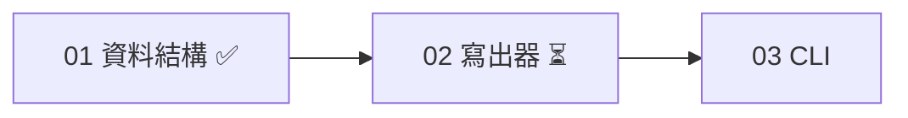

## 工具呼叫

- Skill {"skill": "pm"}
- Read {"file_path": "<tmp>/.claude/skills/pm/references/report.md"}
- Read {"file_path": "<tmp>/.claude/skills/pm/references/check.md"}
- Glob {"pattern": ".scratch/notes/**/*", "path": "<tmp>"}
- Read {"file_path": "<tmp>/.scratch/notes/spec.md"}
- Read {"file_path": "<tmp>/.scratch/notes/issues/01-export-schema.md"}
- Read {"file_path": "<tmp>/.scratch/notes/issues/02-markdown-writer.md"}
- Read {"file_path": "<tmp>/.scratch/notes/issues/03-export-cli.md"}

## 最終回覆

# inkwell 匯出計畫進度報告

**資料來源:** 本機 `.scratch/notes/spec.md` 和 `issues/01~03`,以及 `AGENTS.md`。查詢時間是 2026-10-20。
**覆蓋範圍:** 這裡不是 git repo,也沒有查 GitHub。PR #11 的合併狀態只是工單自己寫的,我沒有獨立驗證。

## 整體進度

**1/3 張工單已關閉(分母 3,沒有取消或範圍外的工單)。** 這個比例只算工單數量,不代表功能完成度。整體驗收「`inkwell export <路徑>` 可匯出 Markdown」尚未達成。

| 工單 | 狀態 | 依賴 | 判斷 |
|---|---|---|---|
| 01 匯出資料結構 | closed | 無 | 完成。工單記載 PR #11 已合併至 main,這點尚未獨立驗證。 |
| 02 Markdown 寫出器 | open,無 assignee | 01 | 前置已滿足,但有待決事項,見下。 |
| 03 匯出 CLI | open,無 assignee | 02 | 要等 02 完成。 |

這是一條線性鏈,沒有環,也沒有缺漏的節點。

## 待決事項

- **Markdown 輸出是否支援表格?**
  - **決定者:** 產品負責人 Dana,出自 02 的 Comments。
  - **影響:** 會改變 02 的範圍,也會改變 03 的輸出格式。
  - **目前狀態:** 沒有看到決定的紀錄。
  - **推論(未驗證):** 02 在前置已滿足的狀況下,可以先做標題、清單、程式碼區塊,這三項不受表格影響。但這樣做要先和 Dana 確認範圍,不然 02 可能要重做。

## 行動項目

- **AI-1(owner: Carl):把測試指令補進 AGENTS.md。**
  - `spec.md` 還標記為 open。
  - 但 `AGENTS.md` 已有「## 測試」一節,寫著 `npm test`,所以內容上看來已完成。
  - 我建議把狀態更新為 done,證據是 `AGENTS.md` 的「測試」一節。這是我的推論,請 Carl 確認。

## 下一步建議

- 可立即開工的是 **02**,它是 ready frontier 上唯一的項目,也沒有人認領。
- 建議先請 Dana 決定表格範圍,再開工。
- 專案規則(`AGENTS.md`)規定實作工單要依 `docs/workflow/build-ticket.md`,commit、push、merge 要使用者明確授權。這次只做報告,沒有動手。

## 若你要我寫入(目前一律沒寫)

- 預設只在對話中交付,沒有建立或修改任何檔案。
- 如果你要記錄:
  - 我會把 AI-1 的狀態改成 done,並附上 `AGENTS.md` 的證據,寫在 `.scratch/notes/spec.md` 的 `## Comments`。
  - 我也會在那裡新增一條行動項目:請 Dana 決定表格範圍,它會影響工單 02 和 03。
- 這份報告要不要寄給別人由你決定,我不會代發。
