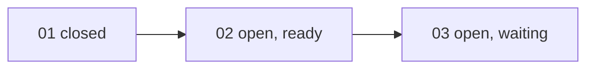

## 工具呼叫

- Skill {"skill": "pm"}
- Read {"file_path": "<tmp>/.claude/skills/pm/references/check.md"}
- Read {"file_path": "<tmp>/.claude/skills/pm/references/report.md"}
- Glob {"pattern": ".scratch/notes/**/*", "path": "<tmp>"}
- Read {"file_path": "<tmp>/.scratch/notes/spec.md"}
- Read {"file_path": "<tmp>/.scratch/notes/issues/01-export-schema.md"}
- Read {"file_path": "<tmp>/.scratch/notes/issues/02-markdown-writer.md"}
- Read {"file_path": "<tmp>/.scratch/notes/issues/03-export-cli.md"}

## 最終回覆

# inkwell「Notes 匯出功能」進度報告

資料來源是本機 `.scratch/notes/spec.md` 和 `issues/01~03`,查詢時間 2026-10-20。這個目錄不是 git repo,我也沒有查 `gh`,所以 PR #11 的合併狀態只能引用工單的文字,沒有獨立驗證。

## 整體進度

**已關閉 1 / 3 張工單(33%)**,沒有取消或排除的工單。這個比例只算張數,不代表功能完成度。整體驗收「`inkwell export <路徑>` 可匯出 Markdown」尚未達成。

| 工單 | 狀態 | 依賴 | 說明 |
| --- | --- | --- | --- |
| 01 匯出資料結構 | closed | 無 | 驗收已勾選,註明 PR #11 已合併至 main(未獨立驗證) |
| 02 Markdown 寫出器 | open,無 assignee | 01 | 01 已完成,所以可以開工,但有待決事項(見下) |
| 03 匯出 CLI 指令 | open,無 assignee | 02 | 要等 02 完成 |

依賴是線性的,沒有循環或缺漏的節點。

## 待決事項

- **Markdown 輸出是否支援表格?**
  - 決策者:產品負責人 Dana(出自 02 的留言)。
  - 影響:02 的範圍和 03 的輸出格式。
  - 目前 02 的驗收只列標題、清單、程式碼區塊。不含表格的部分可以先做,但範圍不確定,開工前建議先請 Dana 決定。

## 行動項目

- **AI-1(owner: Carl)**:把測試指令補進 AGENTS.md。
  - spec 記錄的狀態是 open。
  - 但 AGENTS.md 現在已經有「測試指令:`npm test`」,所以實際上看起來**已完成**(推論:spec 的狀態沒更新)。
  - 建議把 AI-1 標為 done,這需要你授權才會寫入。

## 風險與下一步

- 唯一就緒的工單是 **02**。
- 專案規則(AGENTS.md)指定實作工單走 `docs/workflow/build-ticket.md`。我還沒有確認這個檔案存在,也沒有啟動它。
- 02 是單一工單,適合單張交接。Commit、push、merge 都需要你明確授權。

## 我會寫入的內容(本次只說明,沒有實際寫入)

- 若你同意,在 `.scratch/notes/spec.md` 的 `## Comments` 把 AI-1 狀態改為 done,並註明依據是 AGENTS.md 已含 `npm test`。
- 其他檔案都不會動,也不會對外發送或發布任何東西。
