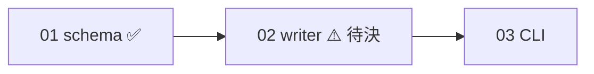

## 工具呼叫

- Skill {"skill": "pm"}
- Read {"file_path": "<tmp>/.claude/skills/pm/references/check.md"}
- Glob {"pattern": ".scratch/notes/**/*", "path": "<tmp>"}
- Read {"file_path": "<tmp>/.scratch/notes/spec.md"}
- Read {"file_path": "<tmp>/.scratch/notes/issues/01-export-schema.md"}
- Read {"file_path": "<tmp>/.scratch/notes/issues/02-markdown-writer.md"}
- Read {"file_path": "<tmp>/.scratch/notes/issues/03-export-cli.md"}
- Read {"file_path": "<tmp>/docs/workflow/build-ticket.md"}

## 最終回覆

# inkwell 匯出計畫進度報告

**資料來源與時間**:`.scratch/notes/spec.md` 和 `issues/01~03`,2026-10-20 讀取。我沒有查 GitHub 或 PR,因為這個目錄不是 git repo。工單裡的 PR 狀態都只是工單自己的記載,我沒有獨立驗證。

## 整體進度

完成 1/3 張工單(分母 3 張,沒有取消或範圍外的工單)。這個比例只算張數,不代表功能完成度。整體驗收(`inkwell export <路徑>` 可匯出 Markdown)尚未達成,計畫未完成。

| 工單 | 狀態 | 依賴 | 分類 |
|---|---|---|---|
| 01 匯出資料結構 | closed | 無 | 已完成。驗收記載 PR #11 已合併至 main,我未獨立驗證。 |
| 02 Markdown 寫出器 | open,無 assignee | 01 | 前置已滿足,但有未決事項,資訊不足。 |
| 03 匯出 CLI 指令 | open,無 assignee | 02 | 等待前置。 |

## 阻塞與風險

- **02 有待決事項**:Markdown 輸出要不要支援表格,需要 Dana 決定。這會影響 02 的範圍和 03 的輸出格式。在決定之前,02 不應當成 ready,03 也跟著卡住。
- 這是一條線性鏈,沒有可以平行處理的分支,所以目前沒有可直接開工的項目。
- 02、03 都沒有 assignee,沒有重複開工的風險。

## 收尾檢查

- 01 是 closed,工單記載的 PR #11 已合併至 main,與交付終點一致。這點因為沒有 `gh`,算「證據有限」。
- 02、03 沒有任何已關聯的 PR,沒有可關閉的項目。
- **行動項目 AI-1**(把測試指令補進 AGENTS.md,owner: Carl,狀態 open):`AGENTS.md` 已寫有「測試指令:`npm test`」。這看起來已經完成,但 spec 仍標為 open。建議由 Carl 確認後更新狀態。
- `AGENTS.md` 指定的流程文件 `docs/workflow/build-ticket.md` 不存在。這是已確認的缺口,會影響之後的交接入口。

## 建議的下一步

1. 請 Dana 決定表格支援。這是目前唯一的關鍵路徑阻塞。
2. 決定後,把結論記入 02 的 Comments,再交由 02 開工。入口原本是 AGENTS.md 指定的 `build-ticket.md`,但該檔案缺失,需要先補上或指定替代入口。
3. 確認 AI-1 是否可以關閉。

## 如果要寫入,我會寫什麼(這次沒有寫)

- 我預計不新增任何檔案,也不更新工單或 spec。
- 如果你同意,可以在 `spec.md` 的 `## Comments` 補一條:「AI-1 已由 AGENTS.md 現有內容滿足,待 Carl 確認結案」。
- 另外可補一條:「`docs/workflow/build-ticket.md` 缺失」。

這次是唯讀模擬,到此為止。
