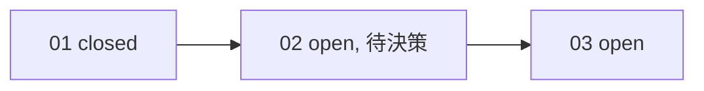

## 工具呼叫

- Skill {"skill": "pm"}
- Read {"file_path": "<tmp>/.claude/skills/pm/references/check.md"}
- Glob {"pattern": ".scratch/notes/**/*", "path": "<tmp>"}
- Read {"file_path": "<tmp>/.scratch/notes/spec.md"}
- Read {"file_path": "<tmp>/.scratch/notes/issues/01-export-schema.md"}
- Read {"file_path": "<tmp>/.scratch/notes/issues/02-markdown-writer.md"}
- Read {"file_path": "<tmp>/.scratch/notes/issues/03-export-cli.md"}
- Glob {"pattern": "docs/workflow/*", "path": "<tmp>"}

## 最終回覆

我不會寫入任何檔案，以下是我打算寫到 `.scratch/notes/status.md` 的內容。這是依 pm skill 的 check 流程整理的唯讀快照。

## 預計寫入 `.scratch/notes/status.md` 的內容

````markdown
# inkwell 匯出計畫進度報告

查詢時間：2026-10-20
資料來源：`.scratch/notes/spec.md`、`.scratch/notes/issues/01~03`、`AGENTS.md`
涵蓋範圍：本機工單檔 3 張。沒有 git repo，也沒有遠端 tracker，所以無法用 `gh` 查 PR。

> 這是某個時間點的快照，不是進度台帳。工單狀態以 `issues/` 為準，行動項目以 `spec.md` 的 `## Comments` 為準。

## 總覽

- 進度：1/3 張工單 closed（分母 3，無取消或範圍外工單）。這個比例只算張數，不代表功能完成度。
- 整體驗收「`inkwell export <路徑>` 可匯出 Markdown」尚未達成。
- 目前沒有可立即開工的工單：02 等待產品決策，03 等待 02。

## 工單狀態

| 工單 | 來源狀態 | Blocked by | 分類 | 備註 |
| --- | --- | --- | --- | --- |
| 01 匯出資料結構 | closed | none | 已完成 | PR #11 已合併至 main，本次無法獨立查證 |
| 02 Markdown 寫出器 | open | 01 | 資訊不足，等待決策 | 01 已滿足，但有未決問題（見下） |
| 03 匯出 CLI 指令 | open | 02 | 等待前置 | 02 完成前不能開始 |

依賴鏈：01 → 02 → 03



## 阻塞與風險

1. **待決：Markdown 輸出是否支援表格。** 02 的 Comments 指出這需要產品負責人 Dana 決定，會影響 02 的範圍和 03 的輸出格式。目前沒有看到 Dana 的回覆。這是整條鏈的關鍵阻塞。
2. **行動項目 AI-1 的狀態可能已過期。** spec 標示為 open（owner: Carl，把測試指令補進 AGENTS.md），但 `AGENTS.md` 的「測試」段落已寫有 `npm test`。這看起來已完成，需要 Carl 確認是否結案。
3. **工作流程文件缺失。** `AGENTS.md` 指定依 `docs/workflow/build-ticket.md` 實作工單，但 `docs/workflow/` 下找不到任何檔案。實作 02 之前要先釐清這份流程在哪裡。

## 結案檢查

- 01：驗收項目已勾選，依檔案內容「符合關閉條件」。PR #11 合併至 main 這一點沒有 tracker 或 git 可以交叉驗證，證據僅限於工單自述。
- 02、03：尚有工作，驗收項目皆未完成。
- 整體驗收：尚有工作。

## 建議下一步

1. 請 Dana 決定 Markdown 是否支援表格，並把決定寫回 02 的 Comments。
2. 決定後 02 即可成為可開工項目，但仍須先補齊或找到 `docs/workflow/build-ticket.md`。
3. 請 Carl 確認 AI-1 是否可結案。

交付終點是所有 PR 合併至 main。目前 PR #11 之外沒有其他 PR 的資訊。
````

## 補充說明

- **只寫報告檔。** pm skill 要求不新增進度檔，但你明確要求 `status.md`。所以我只把它當成唯讀快照，不改 `spec.md`、工單或 AI-1。
- **不推進實作。** 看進度不等於授權開發。依專案規則，commit、push、merge 也都需要你明確授權。
- **需要你確認的事項。** Dana 的決定、AI-1 是否結案，以及 `build-ticket.md` 的位置。
