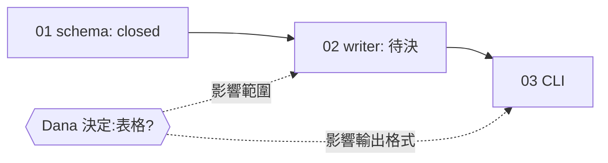

## 工具呼叫

- Skill {"skill": "pm"}
- Read {"file_path": "<tmp>/.claude/skills/pm/references/check.md"}
- Glob {"pattern": ".scratch/notes/**/*", "path": "<tmp>"}
- Read {"file_path": "<tmp>/.scratch/notes/spec.md"}
- Read {"file_path": "<tmp>/.scratch/notes/issues/01-export-schema.md"}
- Read {"file_path": "<tmp>/.scratch/notes/issues/02-markdown-writer.md"}
- Read {"file_path": "<tmp>/.scratch/notes/issues/03-export-cli.md"}
- Read {"file_path": "<tmp>/docs/workflow/build-ticket.md"}

## 最終回覆

# inkwell 匯出功能進度報告

資料來源是本地檔案 `.scratch/notes/spec.md` 和 `issues/01~03`,查詢時間 2026-10-20。這不是 git repo,我沒有查 `gh` 或 PR 狀態。

## 整體進度

3 張工單中 1 張已關閉(1/3,以件數計,沒有取消或範圍外的工單)。整體驗收「`inkwell export <路徑>` 可匯出 Markdown」尚未達成。目前沒有可立即開工的工單,要先等 Dana 決定表格是否支援。

## 狀態表

| 工單 | 來源狀態 | 依賴 | 分類 | 說明 |
|---|---|---|---|---|
| 01 匯出資料結構 | closed | 無 | 完成(證據不足,見下) | 驗收寫「PR #11 已合併至 main」 |
| 02 Markdown 寫出器 | open,無 assignee | 01 | 資訊不足 | 01 已滿足,但有待決事項 |
| 03 匯出 CLI | open,無 assignee | 02 | 等前置 | 被 02 擋住 |

## 阻塞與風險

- **待決事項**:02 的 Comments 寫著 Markdown 是否支援表格要由 Dana 決定。這會改變 02 的範圍和 03 的輸出格式,所以 02 雖然依賴已滿足,我不把它列為 ready。03 也一樣受影響。
- **01 的關閉證據**:01 標示 PR #11 已合併,但我無法驗證。因為不是 git repo,也沒有查 GitHub,所以這是「證據不足」,不是「符合關閉條件」。建議之後用 `gh pr view 11` 確認 PR 已合併到 main。
- **行動項目 AI-1**:spec 的 Comments 記錄「把測試指令補進 AGENTS.md」,狀態是 open,owner 是 Carl。但 AGENTS.md 現在已經有「測試指令:`npm test`」,看起來已完成,只是 spec 還沒更新。我建議確認後把它標為完成,這一步需要你授權。

## 下一步建議

1. 請 Dana 決定表格是否支援。這是目前唯一的阻塞點,決定後 02 才能開工。
2. 專案規則(AGENTS.md)指定用 `docs/workflow/build-ticket.md` 實作工單,而且一次只交一張工單。但這個檔案在 repo 裡找不到。這是需要你確認的缺口:檔案是否漏提交,或路徑有變。在找到之前我不會挑別的流程代替。
3. 前兩項解決後,建議的交接對象是 02,走專案自己的 build-ticket 流程,完成後再接 03。

## 如果你要我寫入,我會寫什麼

我這次沒有寫任何檔案。獲得授權後,我會做兩件事:
- 在 `.scratch/notes/spec.md` 的 `## Comments` 把 AI-1 標為已完成,並註明 AGENTS.md 已含 `npm test`。
- 如果 Dana 做出決定,把結果記到 `issues/02-markdown-writer.md` 的 Comments。
