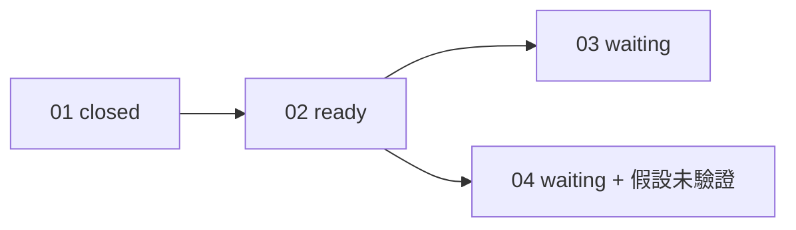

## 工具呼叫

- Skill {"skill": "pm"}
- Read {"file_path": "/private/var/folders/mp/2hbmdcp15qjfn3fhgctttgl40000gn/T/tmp.dYA0Howoos/.claude/skills/pm/references/check.md"}
- Read {"file_path": "/private/var/folders/mp/2hbmdcp15qjfn3fhgctttgl40000gn/T/tmp.dYA0Howoos/.claude/skills/pm/references/risk.md"}
- Glob {"pattern": ".scratch/notes/**", "path": "/private/var/folders/mp/2hbmdcp15qjfn3fhgctttgl40000gn/T/tmp.dYA0Howoos"}
- Read {"file_path": "/private/var/folders/mp/2hbmdcp15qjfn3fhgctttgl40000gn/T/tmp.dYA0Howoos/.scratch/notes/spec.md"}
- Read {"file_path": "/private/var/folders/mp/2hbmdcp15qjfn3fhgctttgl40000gn/T/tmp.dYA0Howoos/.scratch/notes/issues/01-export-schema.md"}
- Read {"file_path": "/private/var/folders/mp/2hbmdcp15qjfn3fhgctttgl40000gn/T/tmp.dYA0Howoos/.scratch/notes/issues/02-markdown-writer.md"}
- Read {"file_path": "/private/var/folders/mp/2hbmdcp15qjfn3fhgctttgl40000gn/T/tmp.dYA0Howoos/.scratch/notes/issues/03-export-cli.md"}
- Read {"file_path": "/private/var/folders/mp/2hbmdcp15qjfn3fhgctttgl40000gn/T/tmp.dYA0Howoos/.scratch/notes/issues/04-table-support.md"}

## 最終回覆

# Notes 匯出功能:進度與風險報告

資料來源是 `.scratch/notes/spec.md` 和 `issues/01~04`,在 2026-10-20 讀取。我沒有 Bash 或 `gh`,所以沒查 PR #11 的實際狀態。這份報告只讀取,沒改任何檔案。

## 進度

4 張工單裡 1 張已關閉(1/4),沒有 canceled 或範圍外的工單。這個比例只算張數,不代表功能完成度。

| 工單 | State | Blocked by | Assignee | 判斷 |
| --- | --- | --- | --- | --- |
| 01 匯出資料結構 | closed | none | 無 | 完成。驗收項已勾選,紀錄為 PR #11 已合併且 schema 測試通過。 |
| 02 Markdown 寫出器 | open | 01 | none | ready,是目前唯一的前沿。 |
| 03 匯出 CLI | open | 02 | none | 等 02。 |
| 04 表格匯出 | open | 02 | none | 等 02,另有未驗證的假設(見風險)。 |

依賴鏈沒有缺漏節點、循環或矛盾狀態,也沒有人在前置條件未滿足時提前開工。

**關閉驗證:** 01 的關閉依據是 PR #11 已合併,但我無法查證這個 PR,所以標為「證據不足」,不是「符合關閉條件」。紀錄內容一致,沒有矛盾。

## 風險

| 風險 | 影響範圍 | 依據 | 證據標籤 | 建議驗證 |
| --- | --- | --- | --- | --- |
| mdlite 是否支援 GFM 表格 | 04。若不支援,04 的做法要換,驗收可能要改。 | spec.md 備註;04 範圍段。兩處都寫「尚未驗證,函式庫文件沒有提到」。 | assumed | 見下方 |
| 單篇轉換小於 50ms | 02,以及依賴 02 的 03、04(效能預期)。 | spec.md 備註,依 beta 使用者平均 3KB 筆記估算,尚未量測。 | inferred | 見下方 |
| 02 驗收未涵蓋表格和效能 | 02 完成後,04 和效能目標沒有對應的驗收。 | 02 驗收只列標題、清單、程式碼區塊,沒有效能項目。 | inferred | 由規劃決定要不要補,PM 不改驗收。 |
| 01 的 schema 驗證只憑紀錄 | 02、03、04 全部。 | 01 和 spec.md 都引用 PR #11;我沒查 PR。 | 紀錄聲稱已驗證,PM 未獨立確認 | 有 `gh` 時唯讀確認 PR #11 已合併到 main。 |

- **風險順序:** 影響最大的是 01 的證據(下游全部),其次是 mdlite 的假設(卡住 04)。因為這是假設,而且 04 要在 02 之後才能開始,建議在 02 進行時就先驗證。
- **未支撐的疑慮:** 資料中沒有 03 的外部前置條件或單點故障的紀錄。我不列沒有依據的風險。

## 驗證提案

我(PM)不執行實驗,下面兩項要交給專案入口。入口來自專案規則:`AGENTS.md` 規定驗證性質的研究或原型,要開一張工單並依 `docs/workflow/research-ticket.md`。

1. **mdlite 表格支援**
   - 假設:mdlite 能把表格轉成 GFM 表格。
   - 方法:用含表格的樣本跑 mdlite,檢查輸出。
   - 通過標準:表格結構完整保留。
   - 通過後:04 可以照原範圍進行。
   - 失敗時:04 要換函式庫或自己實作,可能需要走 `docs/workflow/plan-spec.md` 調整 spec。
2. **轉換時間**
   - 假設:3KB 筆記的單篇轉換小於 50ms。
   - 方法:02 完成後用代表性筆記量測。
   - 通過標準:低於 50ms。
   - 失敗時:要重新檢視效能目標,或優化 02。

這兩項都不會自動啟動。要不要開研究工單、什麼時候開,由你決定。

## 建議的下一步

先做 02,它是唯一 ready 的工單,也沒有人認領。實作入口依 `AGENTS.md` 是 `docs/workflow/build-ticket.md`。你選定後,我會讀取該入口並說明接下來要做什麼,不會自行開工。
