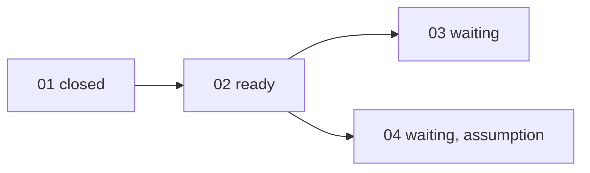

## 工具呼叫

- Skill {"skill": "pm"}
- Read {"file_path": "/private/var/folders/mp/2hbmdcp15qjfn3fhgctttgl40000gn/T/tmp.KhkHzJiOcj/.claude/skills/pm/references/check.md"}
- Read {"file_path": "/private/var/folders/mp/2hbmdcp15qjfn3fhgctttgl40000gn/T/tmp.KhkHzJiOcj/.claude/skills/pm/references/risk.md"}
- Glob {"pattern": ".scratch/notes/**"}
- Read {"file_path": "/private/var/folders/mp/2hbmdcp15qjfn3fhgctttgl40000gn/T/tmp.KhkHzJiOcj/.scratch/notes/spec.md"}
- Read {"file_path": "/private/var/folders/mp/2hbmdcp15qjfn3fhgctttgl40000gn/T/tmp.KhkHzJiOcj/.scratch/notes/issues/01-export-schema.md"}
- Read {"file_path": "/private/var/folders/mp/2hbmdcp15qjfn3fhgctttgl40000gn/T/tmp.KhkHzJiOcj/.scratch/notes/issues/02-markdown-writer.md"}
- Read {"file_path": "/private/var/folders/mp/2hbmdcp15qjfn3fhgctttgl40000gn/T/tmp.KhkHzJiOcj/.scratch/notes/issues/03-export-cli.md"}
- Read {"file_path": "/private/var/folders/mp/2hbmdcp15qjfn3fhgctttgl40000gn/T/tmp.KhkHzJiOcj/.scratch/notes/issues/04-table-support.md"}

## 最終回覆

# .scratch/notes 進度與風險報告

資料來源是 `.scratch/notes/` 下的 spec.md 和 issues/01–04。我在 2026-10-20 讀取這些檔案。目前沒有 Bash 或 `gh`,所以 PR #11 的狀態我查不到。

## 進度

共 4 張工單,沒有取消或範圍外的工單。1 張已關閉(25%),這個比例只代表工單數量。

| 工單 | State | Blocked by | 判斷 |
| --- | --- | --- | --- |
| 01 匯出資料結構 | closed | none | 已完成。工單寫明 PR #11 已合併且 schema 測試通過,但我沒有查證 PR。 |
| 02 Markdown 寫出器 | open | 01 | **Ready**。前置已關閉,無 assignee。 |
| 03 匯出 CLI | open | 02 | 等 02 完成。 |
| 04 表格匯出 | open | 02 | 等 02 完成,另有未驗證的假設(見風險 2)。 |

- 依賴關係沒有缺漏、循環或自相矛盾的狀態。
- 目前只有 02 可以開工。它是 03 和 04 共同的前置,所以是最有價值的下一步。
- 結案檢查:01 已是 closed,不需動作。其餘 open 工單沒有在檔案中引用 PR,所以沒有可核對的結案證據。

## 風險

| # | 風險 | 影響範圍 | 依據 | 證據標籤 | 建議驗證 |
| --- | --- | --- | --- | --- | --- |
| 1 | **mdlite 可能不支援 GFM 表格。** spec 和工單 04 都寫「尚未驗證」,函式庫文件也沒提到。 | 04 本身。若要換函式庫或自行實作,可能牽動 02 的寫出器設計,並影響 03 的輸出。 | spec.md 備註第 3 點、04 的範圍段 | **assumed** | 見下方驗證提案 |
| 2 | **單篇轉換 <50ms 的效能預估沒有量測。** 它是依 beta 使用者平均 3KB 筆記估算的。 | 02,以及依賴 02 的 03、04。 | spec.md 備註第 2 點 | **inferred**。平均大小不代表大型筆記,也不是實測。 | 02 完成後用實際筆記量測,並納入大型筆記。 |
| 3 | **PR #11 的合併與測試結果我無法獨立確認。** | 01,以及 02 以後所有後代工單。 | spec.md 備註第 1 點、01 的驗收 | 來源有引用證據(合併的 PR、schema 測試通過),但 PM 沒有查證。這一項不是風險,只是查核缺口。 | 有 `gh` 或 git 時,確認 #11 已合併到 main。 |

另外兩點與風險有關:
- 02 的驗收只要求單元測試涵蓋標題、清單、程式碼區塊,沒有涵蓋表格和效能。這與風險 1、2 一致,而且在 04 開始前不會被發現。這是我的推論。
- 03 的驗收只有「可輸出到指定路徑」,沒有錯誤情形,例如路徑不存在或沒有寫入權限。這也是我的推論,不是來源的陳述。

## 驗證提案(PM 不執行)

風險 1 需要實際試跑 mdlite,超出 PM 唯讀驗證的範圍。建議交給專案入口處理。
- **入口來源**:AGENTS.md 的專案規則,「驗證性質的研究或原型:開一張工單,依 `docs/workflow/research-ticket.md`」。我沒有讀那份文件。
- **假設**:mdlite 能把表格轉成結構完整的 GFM 表格。
- **方法**:用幾份含表格的樣本筆記試跑 mdlite。
- **通過條件**:輸出的表格結構完整,與 04 的驗收一致。
- **通過後**:04 的假設成立,可照原範圍進行。
- **失敗後**:04 需要依 `docs/workflow/plan-spec.md` 重新規劃,例如換函式庫或縮小範圍。

這個驗證不必等 02 完成,可以與 02 並行。

## 未寫入的項目

我沒有修改任何檔案、建立工單或寫入留言。如果你要把上述風險措施寫進工單的 `## Comments`,或啟動研究工單,請告訴我。我會用「單次交接」的方式處理,這需要你明確授權。
