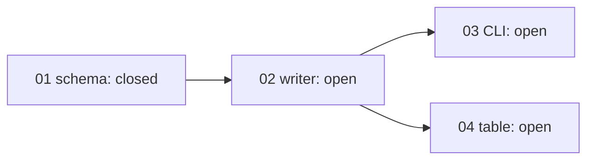

## 工具呼叫

- Skill {"skill": "pm"}
- Read {"file_path": "/private/var/folders/mp/2hbmdcp15qjfn3fhgctttgl40000gn/T/tmp.eewD3tZwO8/.claude/skills/pm/references/check.md"}
- Read {"file_path": "/private/var/folders/mp/2hbmdcp15qjfn3fhgctttgl40000gn/T/tmp.eewD3tZwO8/.claude/skills/pm/references/risk.md"}
- Glob {"pattern": ".scratch/notes/**", "path": "/private/var/folders/mp/2hbmdcp15qjfn3fhgctttgl40000gn/T/tmp.eewD3tZwO8"}
- Read {"file_path": "/private/var/folders/mp/2hbmdcp15qjfn3fhgctttgl40000gn/T/tmp.eewD3tZwO8/.scratch/notes/spec.md"}
- Read {"file_path": "/private/var/folders/mp/2hbmdcp15qjfn3fhgctttgl40000gn/T/tmp.eewD3tZwO8/.scratch/notes/issues/01-export-schema.md"}
- Read {"file_path": "/private/var/folders/mp/2hbmdcp15qjfn3fhgctttgl40000gn/T/tmp.eewD3tZwO8/.scratch/notes/issues/02-markdown-writer.md"}
- Read {"file_path": "/private/var/folders/mp/2hbmdcp15qjfn3fhgctttgl40000gn/T/tmp.eewD3tZwO8/.scratch/notes/issues/03-export-cli.md"}
- Read {"file_path": "/private/var/folders/mp/2hbmdcp15qjfn3fhgctttgl40000gn/T/tmp.eewD3tZwO8/.scratch/notes/issues/04-table-support.md"}

## 最終回覆

# `.scratch/notes` 進度與風險報告

資料來源是 `spec.md` 和 `issues/01~04`,讀取時間為 2026-10-20。這次沒有 Bash 或 `gh`,也不是 git 倉庫,所以我無法查 PR #11 的實際狀態,只能採信工單和 spec 的文字。

## 進度

4 張工單,1 張 closed,3 張 open,完成率 1/4。沒有 canceled 或範圍外的工單,所以分母就是 4。這個比例只算張數,不代表功能完成度。

| 工單 | State | Blocked by | Assignee | 狀態判斷 |
| --- | --- | --- | --- | --- |
| 01 匯出資料結構 | closed | none | — | 完成。驗收項已勾選,記載 PR #11 已合併且 schema 測試通過。 |
| 02 Markdown 寫出器 | open | 01 | none | 就緒,是唯一的 ready frontier,沒人認領。 |
| 03 匯出 CLI | open | 02 | none | 等 02。 |
| 04 表格匯出 | open | 02 | none | 等 02,且有未驗證的前提(見風險 1)。 |

- **依賴關係**:沒有缺漏節點、循環或矛盾狀態,也沒有在前置未完成時就先動工的工單。
- **關閉證據**:01 的 PR #11 只有工單文字作證,我沒法對照 PR 本身,所以這項是「採信記載」,不是我查證過的結果。
- **下一步**:最有價值的是 02。它擋住 03 和 04,也就是全部剩餘工作。

## 風險

| # | 風險 | 影響範圍 | 依據 | 證據標記 | 建議驗證 |
| --- | --- | --- | --- | --- | --- |
| 1 | mdlite 是否支援 GFM 表格,沒有人驗證過,函式庫文件也沒提到。 | 04 整張工單,以及表格匯出這項功能。 | `spec.md` 備註第 3 點;`04-table-support.md` 範圍段。 | assumed | 見下方研究工單。 |
| 2 | 02 的「單篇轉換小於 50ms」只是依 3KB 平均筆記估算,沒有量測。 | 02,間接影響 03 的使用體驗。 | `spec.md` 備註第 2 點,spec 自己標了「推論」。 | inferred | 02 實作後量測,或併入研究工單。 |
| 3 | 02 的驗收只涵蓋標題、清單、程式碼區塊,沒有涵蓋表格、50ms 目標,也沒有涵蓋 03 要輸出的完整檔案內容。 | 02 的驗收完整性,影響 03 和 04 的銜接。 | `02-markdown-writer.md` 驗收段與 `spec.md` 備註對照。 | inferred | 由規劃入口決定要不要補驗收項。 |
| 4 | 01 的結構已驗證,但我無法確認 PR #11 的狀態。 | 01 以及所有後代工單。 | `01-export-schema.md`、`spec.md` 備註第 1 點。 | 文字記載有證據,PM 未獨立查證 | 有 `gh` 權限時查 PR #11 的合併目標與測試結果。 |

風險 1 影響最大。如果 mdlite 不支援 GFM 表格,04 的做法就得改,例如換函式庫或自己實作,它的範圍和工作量會一起變。03 不受影響,因為它只依賴 02。

## 建議的驗證與入口

驗證 mdlite 要寫小程式實測,PM 不能自己跑。建議開一張研究工單,內容是:

- **假設**:mdlite 能把表格輸出成 GFM 表格。
- **方法**:用含表格的樣本實測。
- **通過標準**:輸出的表格結構完整。
- **結果的影響**:通過就解除 04 的前提;不通過就要改 04 的範圍或做法。

入口來自專案規則。`AGENTS.md` 規定驗證性質的研究或原型要「開一張工單,依 `docs/workflow/research-ticket.md`」。這次沒有展開執行,也沒讀那份文件。

這次只做了報告,沒有改任何檔案,也沒有建立工單、認領工單或寫入留言。如果要開研究工單或接著做 02,請告訴我要走哪一個入口。
