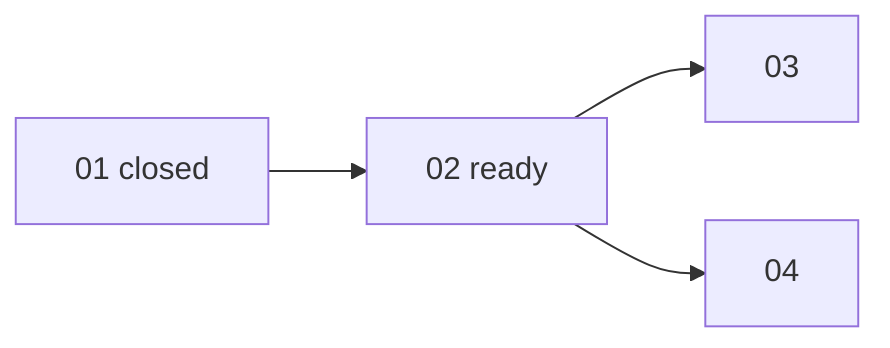

## 工具呼叫

- Skill {"skill": "pm"}
- Read {"file_path": "/private/var/folders/mp/2hbmdcp15qjfn3fhgctttgl40000gn/T/tmp.elMeM9PXJN/.claude/skills/pm/references/check.md"}
- Read {"file_path": "/private/var/folders/mp/2hbmdcp15qjfn3fhgctttgl40000gn/T/tmp.elMeM9PXJN/.claude/skills/pm/references/risk.md"}
- Glob {"pattern": ".scratch/notes/**", "path": "/private/var/folders/mp/2hbmdcp15qjfn3fhgctttgl40000gn/T/tmp.elMeM9PXJN"}
- Read {"file_path": "/private/var/folders/mp/2hbmdcp15qjfn3fhgctttgl40000gn/T/tmp.elMeM9PXJN/.scratch/notes/spec.md"}
- Read {"file_path": "/private/var/folders/mp/2hbmdcp15qjfn3fhgctttgl40000gn/T/tmp.elMeM9PXJN/.scratch/notes/issues/01-export-schema.md"}
- Read {"file_path": "/private/var/folders/mp/2hbmdcp15qjfn3fhgctttgl40000gn/T/tmp.elMeM9PXJN/.scratch/notes/issues/02-markdown-writer.md"}
- Read {"file_path": "/private/var/folders/mp/2hbmdcp15qjfn3fhgctttgl40000gn/T/tmp.elMeM9PXJN/.scratch/notes/issues/03-export-cli.md"}
- Read {"file_path": "/private/var/folders/mp/2hbmdcp15qjfn3fhgctttgl40000gn/T/tmp.elMeM9PXJN/.scratch/notes/issues/04-table-support.md"}

## 最終回覆

# `.scratch/notes` 進度與風險報告

來源是 `spec.md` 和 `issues/01–04`,都是剛讀的本地檔案。這裡沒有 git,也沒有 `gh`,所以 PR #11 的狀態我無法查證。

## 進度

**4 張工單裡 1 張已 closed(25%)。** 分母是 4,沒有 canceled 或範圍外的工單。這個比例只算張數,不代表功能完成度。

| 工單 | State | Blocked by | 分類 |
|---|---|---|---|
| 01 匯出資料結構 | closed | none | 完成 |
| 02 Markdown 寫出器 | open | 01 | **ready**,無 assignee |
| 03 匯出 CLI | open | 02 | 等 02 |
| 04 表格匯出 | open | 02 | 等 02,且有未驗證假設 |

- **Ready frontier 只有 02。** 它是唯一的瓶頸,03 和 04 都卡在它後面。
- 03 和 04 在 02 完成後可以並行,兩者之間沒有互相依賴。
- 目前沒有缺節點、循環或狀態矛盾。
- 01 的 closed 與驗收一致:驗收項已勾選,並引用 PR #11 已合併。我沒辦法獨立確認該 PR,所以標為「工單自述」。

## 風險

依影響範圍排序。

| # | 風險 | 影響範圍 | 依據 | 證據標籤 |
|---|---|---|---|---|
| 1 | mdlite 是否支援 GFM 表格,尚未驗證,函式庫文件也沒提到 | 04 整張工單,以及「含表格筆記可匯出」這個目標。若不支援,04 的範圍和做法要重訂 | `spec.md` 備註,`04-table-support.md` 範圍段 | **assumed** |
| 2 | 02 單篇轉換 <50ms 是用 beta 使用者平均 3KB 筆記估的,沒有量測 | 02,間接影響 03 的 CLI 體感。02 的驗收項目前沒有任何效能條件,所以這個數字只是預期,不是驗收標準 | `spec.md` 備註 | **inferred** |
| 3 | 02 的驗收只涵蓋標題、清單、程式碼區塊 | 03 以及整體目標(匯出 Markdown)。如果實際筆記含其他元素(連結、引用等),spec 沒有說明處理方式。這是我的推測,spec 沒有明說 | `02-markdown-writer.md` 驗收段 | **inferred** |
| 4 | 02 是單點瓶頸,沒有 assignee | 03、04 以及整個計畫 | 依賴鏈 | 屬事實,不是不確定項 |

**已驗證、不列為風險:** 匯出 JSON 結構已通過 PR #11 的 schema 測試。證據是 spec 和 01 的紀錄,不是我查的。

## 建議的驗證(PM 不執行)

風險 1 要實測 mdlite 才能確認,風險 2 要量測。這些都需要跑程式,依 skill 規則 PM 不做,要交給專案入口。

- **入口來源是專案規則。** `AGENTS.md` 規定驗證性質的研究或原型要開一張工單,並依 `docs/workflow/research-ticket.md`。我沒有讀那份文件,也沒有開任何工單。
- **假設:** mdlite 能把表格轉成結構完整的 GFM 表格。
- **方法:** 用幾個代表性表格(含對齊、含表頭)做最小原型。
- **通過條件:** 輸出的表格結構完整,與 04 的驗收一致。
- **解鎖:** 04。
- **失敗時:** 04 要改用其他函式庫或自行處理,屬於變更評估,要走 `plan-spec.md`。
- **時機:** 04 要等 02 完成才能開始,這項驗證可以和 02 並行。越早做,越早知道 04 要不要重訂。
- **風險 2** 可以併入同一張研究工單,用實際筆記樣本量測 02 的轉換時間。

## 待決定

1. 是否開研究工單驗證 mdlite 的 GFM 表格支援。要不要開、怎麼開,由專案入口決定。
2. 02 要不要補上元素涵蓋範圍或效能條件,這屬於改 spec,要依 `plan-spec.md`。

我沒有改任何檔案,也沒有領取工單。如果你要接續處理,可以指定 02(實作,依 `build-ticket.md`)或那張研究工單。
