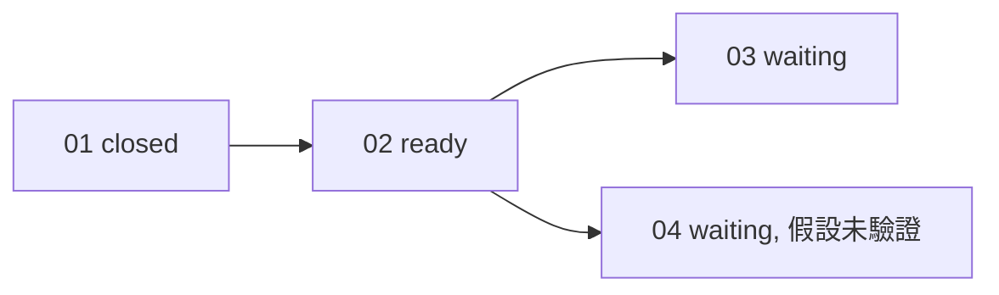

## 工具呼叫

- Skill {"skill": "pm"}
- Read {"file_path": "/private/var/folders/mp/2hbmdcp15qjfn3fhgctttgl40000gn/T/tmp.xXzimeCC9c/.claude/skills/pm/references/check.md"}
- Read {"file_path": "/private/var/folders/mp/2hbmdcp15qjfn3fhgctttgl40000gn/T/tmp.xXzimeCC9c/.claude/skills/pm/references/risk.md"}
- Glob {"pattern": ".scratch/notes/**"}
- Read {"file_path": "/private/var/folders/mp/2hbmdcp15qjfn3fhgctttgl40000gn/T/tmp.xXzimeCC9c/.scratch/notes/spec.md"}
- Read {"file_path": "/private/var/folders/mp/2hbmdcp15qjfn3fhgctttgl40000gn/T/tmp.xXzimeCC9c/.scratch/notes/issues/01-export-schema.md"}
- Read {"file_path": "/private/var/folders/mp/2hbmdcp15qjfn3fhgctttgl40000gn/T/tmp.xXzimeCC9c/.scratch/notes/issues/02-markdown-writer.md"}
- Read {"file_path": "/private/var/folders/mp/2hbmdcp15qjfn3fhgctttgl40000gn/T/tmp.xXzimeCC9c/.scratch/notes/issues/03-export-cli.md"}
- Read {"file_path": "/private/var/folders/mp/2hbmdcp15qjfn3fhgctttgl40000gn/T/tmp.xXzimeCC9c/.scratch/notes/issues/04-table-support.md"}

## 最終回覆

# `.scratch/notes` 進度與風險報告

資料來源是 `.scratch/notes/spec.md` 和 `issues/01~04`,查詢時間 2026-10-20。這次只讀檔,沒有修改任何東西。沒有 Bash 和 `gh`,所以 PR #11 的狀態無法查證,只能引用工單的記載。

## 進度

共 4 張工單,1 張 closed,完成 1/4(25%)。這個比例只算張數,不代表工作量。沒有 canceled 或範圍外的工單。

| 工單 | State | Blocked by | 判斷 |
| --- | --- | --- | --- |
| 01 匯出資料結構 | closed | none | 完成。工單記載 PR #11 已合併、schema 測試通過,我沒查證 |
| 02 Markdown 寫出器 | open | 01 | **就緒**:前置已完成,無 assignee,尚未開始 |
| 03 匯出 CLI | open | 02 | 等 02 |
| 04 表格匯出 | open | 02 | 等 02,另有未驗證的假設 |

依賴關係沒有缺漏節點、循環或互相矛盾的狀態。下一步最有價值的是 02,因為 03 和 04 都卡在它後面。

## 風險

| 風險 | 影響範圍 | 依據 | 證據標籤 | 建議驗證 |
| --- | --- | --- | --- | --- |
| mdlite 可能不支援 GFM 表格 | 04 的整張工單;若要換函式庫,可能連帶影響 02 的寫出器設計 | `spec.md` 備註、`04-table-support.md`:「未驗證,函式庫文件沒有提到」 | **assumed** | 做驗證性研究,見下方 |
| 單篇轉換小於 50ms | 02,以及 03 的使用體驗 | `spec.md` 備註:「推論…尚未量測」,是用 3KB 平均筆記估的 | **inferred** | 02 完成後用真實筆記量測;目前不阻擋任何工單 |
| 02 驗收未涵蓋表格 | 02 與 04 的邊界 | 02 只要求標題、清單、程式碼區塊 | inferred(我的推論) | 如果 mdlite 不支援表格,需要決定表格由 02 還是 04 處理 |
| 01 已關閉,但 PR #11 未查證 | 01,以及 02、03、04 | `spec.md` 和 01 都只引用 PR #11 | 工單有記載,PM 沒查證 | 用 `gh` 查 PR #11 的合併目標與測試結果 |
| 03 的驗收只有「輸出到指定路徑」 | 03 | `03-export-cli.md` 沒有涵蓋錯誤情況,例如路徑不存在或沒有寫入權限 | inferred | 需要補驗收條件時,依 `docs/workflow/plan-spec.md` 處理 |

優先處理 mdlite 的 GFM 表格假設。它會影響 04 能不能做,也可能影響 02 的設計,而且一直沒有人驗證。01 的 schema 已有測試證據,不列為風險。

## 建議的驗證與入口

PM 不做實驗或原型。建議開一張研究工單,內容如下:
- **假設**:mdlite 支援 GFM 表格。
- **方法**:查 mdlite 原始碼和文件,並實際轉換一個含表格的範例。
- **通過標準**:輸出的表格結構完整。
- **解除的阻擋**:04 可以放心執行。
- **失敗時的後果**:04 要換函式庫,或調整範圍。

入口來自專案規則 `AGENTS.md`:驗證性質的研究走 `docs/workflow/research-ticket.md`。我沒讀那份文件,也沒建立工單。

## 建議的下一步

- 02 可以直接交給 `docs/workflow/build-ticket.md`(同樣來自 `AGENTS.md`)。
- mdlite 的研究工單可以與 02 並行,因為 02 不依賴它。
- 要補驗收條件或調整範圍,依 `docs/workflow/plan-spec.md`。
- 我沒有寫入任何風險措施。需要寫進工單的 `## Comments` 時,請授權後再做。
