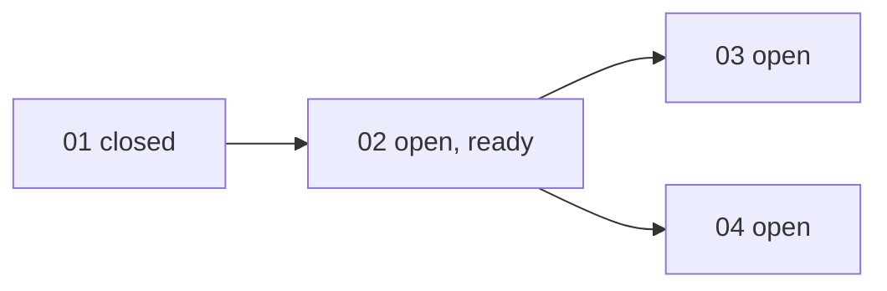

## 工具呼叫

- Skill {"skill": "pm"}
- Read {"file_path": "/private/var/folders/mp/2hbmdcp15qjfn3fhgctttgl40000gn/T/tmp.vjRMCmx7uX/.claude/skills/pm/references/check.md"}
- Glob {"pattern": ".scratch/notes/**", "path": "/private/var/folders/mp/2hbmdcp15qjfn3fhgctttgl40000gn/T/tmp.vjRMCmx7uX"}
- Read {"file_path": "/private/var/folders/mp/2hbmdcp15qjfn3fhgctttgl40000gn/T/tmp.vjRMCmx7uX/.scratch/notes/spec.md"}
- Read {"file_path": "/private/var/folders/mp/2hbmdcp15qjfn3fhgctttgl40000gn/T/tmp.vjRMCmx7uX/.scratch/notes/issues/01-export-schema.md"}
- Read {"file_path": "/private/var/folders/mp/2hbmdcp15qjfn3fhgctttgl40000gn/T/tmp.vjRMCmx7uX/.scratch/notes/issues/02-markdown-writer.md"}
- Read {"file_path": "/private/var/folders/mp/2hbmdcp15qjfn3fhgctttgl40000gn/T/tmp.vjRMCmx7uX/.scratch/notes/issues/03-export-cli.md"}
- Read {"file_path": "/private/var/folders/mp/2hbmdcp15qjfn3fhgctttgl40000gn/T/tmp.vjRMCmx7uX/.scratch/notes/issues/04-table-support.md"}

## 最終回覆

**結論:先不要取消 02。取消會讓 03 和 04 都卡住,而且「改用 pandoc」是否可行目前沒有任何驗證。**

資料來源是 `.scratch/notes/spec.md` 和 `issues/01~04`,我剛剛讀的檔案。沒有 Bash,所以 PR #11 是否真的已合併,我無法查證。

## 目前進度

不含已取消的工單,共 4 張:1 張 closed,3 張 open。

02 目前是 ready,`Assignee: none`,沒人在做。

## 取消 02 的影響

- **03 和 04 會繼續被擋住。** 兩張都是 `Blocked by: 02`。依 PM 規則,取消前置工單不會自動放行下游,除非明確豁免或有替代工單。取消後要二選一:
  - 新開一張 pandoc 轉換工單,03 和 04 改成 `Blocked by` 它。
  - 明確豁免 03 和 04 對 02 的依賴。
- **04 的前提會失效。** 04 的範圍是「以 mdlite 轉成 GFM 表格」,而它依賴的 mdlite 表格支援本來就沒驗證過。改用 pandoc 後,04 的範圍和驗收都要重寫,這等於改 spec,要走 `docs/workflow/plan-spec.md`。
- **02 的驗收標準要有人接手。** 標題、清單、程式碼區塊的測試覆蓋,取消後要轉到替代工單。
- **spec 備註會作廢。** 「單篇轉換小於 50ms」是推論,從沒量測過。換成 pandoc 後要另外評估。spec 也要重寫。
- **03 的 CLI 會多一個外部依賴。** 使用者環境必須裝有 pandoc,這是新的安裝需求和失敗情境。

## 還不知道的事

這些我都沒有證據,不拿來當結論:
- pandoc 能不能直接吃 inkwell 的匯出 JSON。我推測不能,因為 pandoc 的 JSON 輸入是它自己的 AST 格式,所以大概仍需要一個轉換層。這是推論。
- pandoc 的效能和穩定性,以及它對 GFM 表格的支援。
- 目標使用者能不能安裝 pandoc。

## 建議

在決定前先開一張驗證性質的研究工單,依 `docs/workflow/research-ticket.md`。這是專案規則,不是 skill 建議。研究要回答三件事:
1. inkwell JSON 轉 pandoc 輸入要多少工。
2. 表格是否完整輸出。
3. 外部依賴能不能接受。

等研究結果出來,你決定取消後,我再一次改好以下幾件事:
- 02 的 `State: canceled`,並在 `## Comments` 寫明理由。
- 03 和 04 的 `Blocked by`。
- 04 的範圍。
- 新的替代工單。

這些改動你已授權,但等你決定才會動手。要我現在開那張研究工單嗎?我先停在這裡。
