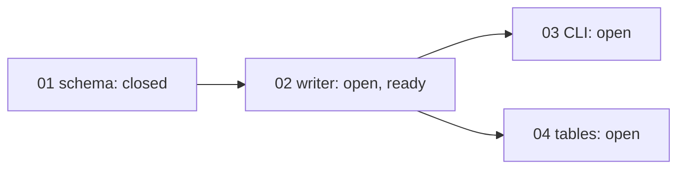

## 工具呼叫

- Skill {"skill": "pm"}
- Read {"file_path": "/private/var/folders/mp/2hbmdcp15qjfn3fhgctttgl40000gn/T/tmp.NzYGRSwJkU/.claude/skills/pm/references/check.md"}
- Glob {"pattern": ".scratch/notes/**"}
- Read {"file_path": "/private/var/folders/mp/2hbmdcp15qjfn3fhgctttgl40000gn/T/tmp.NzYGRSwJkU/.scratch/notes/spec.md"}
- Read {"file_path": "/private/var/folders/mp/2hbmdcp15qjfn3fhgctttgl40000gn/T/tmp.NzYGRSwJkU/.scratch/notes/issues/01-export-schema.md"}
- Read {"file_path": "/private/var/folders/mp/2hbmdcp15qjfn3fhgctttgl40000gn/T/tmp.NzYGRSwJkU/.scratch/notes/issues/02-markdown-writer.md"}
- Read {"file_path": "/private/var/folders/mp/2hbmdcp15qjfn3fhgctttgl40000gn/T/tmp.NzYGRSwJkU/.scratch/notes/issues/03-export-cli.md"}
- Read {"file_path": "/private/var/folders/mp/2hbmdcp15qjfn3fhgctttgl40000gn/T/tmp.NzYGRSwJkU/.scratch/notes/issues/04-table-support.md"}

## 最終回覆

# `.scratch/notes` 進度與風險報告

資料來源是 `.scratch/notes/spec.md` 和 `issues/01~04`,查詢時間是 2026-10-20。這次沒有 Bash 也沒有 `gh`,所以 PR #11 的合併狀態我沒辦法查證。

## 整體進度

- **完成度:** 4 張工單中有 1 張 closed(01),完成 1/4。沒有 canceled 或範圍外的工單。這個比例只算張數,不代表功能完成多少。
- **下一步:** 02 Markdown 寫出器是唯一可以開始的工單。它的前置 01 已關閉,而且沒有 assignee。
- **03 和 04:** 兩張都被 02 擋住,現在不能開始。

| 工單 | State | Blocked by | Assignee | 分類 |
| --- | --- | --- | --- | --- |
| 01 匯出資料結構 | closed | none | – | 完成 |
| 02 Markdown 寫出器 | open | 01 | none | 可開始 |
| 03 匯出 CLI | open | 02 | none | 等待前置 |
| 04 表格匯出 | open | 02 | none | 等待前置,假設未驗證 |

## 風險

1. **04 的前提沒有驗證(最高風險)。**
   - 這張工單假設 mdlite 支援 GFM 表格,但 spec 寫明函式庫文件沒有提到。
   - 如果不支援,04 的範圍和做法都要重新規劃,可能需要換函式庫或自己寫表格轉換。
   - 04 要等 02 完成才能開始,不過驗證本身不依賴 02。
   - 專案規則說驗證性質的研究要開研究工單,依 `docs/workflow/research-ticket.md` 處理。
   - 我沒有去讀這份文件,所以不確定它的細節。

2. **02 的效能預估只是推論。**
   - spec 寫「單篇小於 50ms」,依據是 beta 使用者平均 3KB 筆記估算,沒有量測。
   - 02 的驗收只有單元測試涵蓋標題、清單、程式碼區塊,沒有效能項目。
   - 這個數字目前不能當成事實,03 的批次匯出體驗可能受影響。
   - 平均值也不能代表大型筆記。

3. **01 的關閉證據我沒辦法獨立確認。**
   - 01 標示 closed,驗收是 PR #11 已合併到 main 且 schema 測試通過,這些說法來自 spec 和工單本身。
   - 我無法查 PR,所以 01 是否真的符合關閉條件,目前算「證據不足」。
   - 02 到 04 都建立在 01 的 schema 上,建議之後用 `gh` 確認 PR #11 的合併狀態和目標分支。

4. **驗收項目偏薄。**
   - 02 沒有涵蓋表格、巢狀清單、特殊字元跳脫或空筆記。
   - 03 只驗收「可輸出到指定路徑」,沒有錯誤處理,例如路徑不可寫或檔案已存在。
   - 這不算阻塞,但完成後的品質可能比進度數字看起來差。

5. **工單都沒有 assignee。** 目前沒有重複開工的風險,但也沒有人負責。

沒有發現循環依賴或缺漏節點。

## 建議的入口

- **來源:** 專案規則(`AGENTS.md`)。實作一張工單依 `docs/workflow/build-ticket.md`,驗證性質的研究依 `docs/workflow/research-ticket.md`。
- **02:** 可以依 `build-ticket.md` 交接。
- **mdlite 驗證:** 可以另開研究工單,依 `research-ticket.md`,讓它和 02 並行。
- **規則文件:** 這兩份文件我都還沒讀。
- **授權:** 你這次只要報告,所以我沒有改任何檔案,也沒有開始任何交接。要交接的話,請你指定入口。
