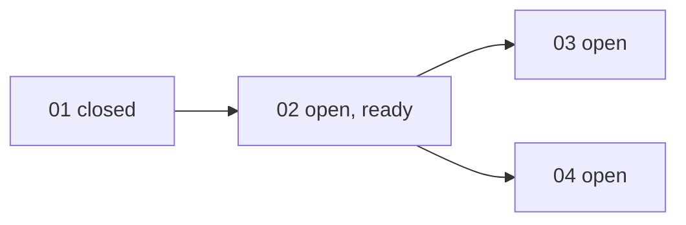

## 工具呼叫

- Skill {"skill": "pm"}
- Read {"file_path": "/private/var/folders/mp/2hbmdcp15qjfn3fhgctttgl40000gn/T/tmp.4KBrrWW38d/.claude/skills/pm/references/check.md"}
- Glob {"pattern": ".scratch/notes/**"}
- Read {"file_path": "/private/var/folders/mp/2hbmdcp15qjfn3fhgctttgl40000gn/T/tmp.4KBrrWW38d/.scratch/notes/spec.md"}
- Read {"file_path": "/private/var/folders/mp/2hbmdcp15qjfn3fhgctttgl40000gn/T/tmp.4KBrrWW38d/.scratch/notes/issues/01-export-schema.md"}
- Read {"file_path": "/private/var/folders/mp/2hbmdcp15qjfn3fhgctttgl40000gn/T/tmp.4KBrrWW38d/.scratch/notes/issues/02-markdown-writer.md"}
- Read {"file_path": "/private/var/folders/mp/2hbmdcp15qjfn3fhgctttgl40000gn/T/tmp.4KBrrWW38d/.scratch/notes/issues/03-export-cli.md"}
- Read {"file_path": "/private/var/folders/mp/2hbmdcp15qjfn3fhgctttgl40000gn/T/tmp.4KBrrWW38d/.scratch/notes/issues/04-table-support.md"}
- Glob {"pattern": "docs/workflow/*.md"}

## 最終回覆

## `.scratch/notes` 的風險與未驗證假設

資料來源是本機檔案 `.scratch/notes/spec.md` 和 `issues/01~04`,查詢時間為 2026-10-20。我沒有 `gh` 和 Bash,所以 PR #11 只能引用工單與 spec 的文字,沒有查證。

**進度:** 4 張工單中,1 張 closed(01),3 張 open(02、03、04)。完成比例 1/4,以工單數計算,不代表功能完成度,沒有 canceled 或範圍外的工單。

### 未驗證的假設與風險

| # | 項目 | 狀態 | 影響 |
|---|---|---|---|
| 1 | **mdlite 是否支援 GFM 表格**(04、spec)。工單自己寫「未驗證」,函式庫文件也沒提到。 | 未驗證 | 這是 04 能否成立的前提。若不支援,04 要改用其他函式庫或自行實作,範圍和估時都會變。這是最大風險。 |
| 2 | **02 單篇轉換小於 50ms**。spec 說這是依 beta 使用者平均 3KB 筆記估算的推論,沒有量測。 | 推論 | 平均值不代表尾端。大筆記或含表格的筆記可能超標。目前也沒有任何工單把這個目標寫成驗收條件。 |
| 3 | **01 已完成**。依據是「PR #11 已合併至 main,schema 測試通過」。 | 證據待確認 | 這只引用了工單文字,我沒有核對 PR 的合併狀態和目標分支。 |
| 4 | **schema 測試只驗證結構**。測試通過不等於結構能滿足 02 的標題、清單、程式碼區塊,也不等於能滿足 04 的表格。 | 推論 | 01 的 schema 是否能表達表格,目前沒有證據。如果不能,04 還會牽動已 closed 的 01。 |

### 驗收條件的缺口

- 02 的驗收只涵蓋標題、清單、程式碼區塊,沒有涵蓋表格、巢狀結構或邊界情況。
- 03 只要求「可輸出到指定路徑」。沒有涵蓋錯誤路徑、覆寫既有檔案,也沒有端對端驗收。
- 04 依賴 02,但沒有依賴任何「驗證 mdlite」的工單。這個假設目前沒有任何工單負責驗證。

### 目前可以開始的工作

- **ready:** 02。它只被已 closed 的 01 擋住,沒有 assignee。
- **等待 02:** 03 和 04。
- 04 雖然在依賴上要等 02,但它的前提(風險 1)獨立於 02,可以先驗證。

### 建議的下一步

1. **開一張研究工單驗證 mdlite 的 GFM 表格支援。** 這屬於驗證性質的研究或原型,依 AGENTS.md(專案規則)應走 `docs/workflow/research-ticket.md`。它可以和 02 並行,結果決定 04 是否要改規劃。
2. **02 可以直接實作。** 入口是 `docs/workflow/build-ticket.md`(專案規則)。建議順便量測轉換時間,並把 50ms 寫成驗收條件,或者明確宣告不納入。
3. 如果研究結果顯示 mdlite 不支援 GFM 表格,就要改 spec 或重新規劃,入口是 `docs/workflow/plan-spec.md`。

這只是審查和建議,沒有改任何檔案、工單或 tracker。要開研究工單或實作 02,請告訴我選哪一個。我會先讀對應的 workflow 文件再動手。Commit、push、merge 仍需要你明確授權。
