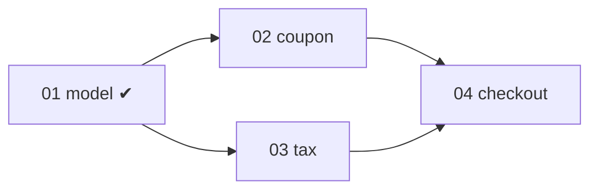

## 工具呼叫

- Skill {"skill": "pm", "args": "plan .scratch/cart"}
- Read {"file_path": "/private/var/folders/mp/2hbmdcp15qjfn3fhgctttgl40000gn/T/tmp.6Xb7WUCKni/.claude/skills/pm/references/check.md"}
- Read {"file_path": "/private/var/folders/mp/2hbmdcp15qjfn3fhgctttgl40000gn/T/tmp.6Xb7WUCKni/.claude/skills/pm/references/next-step.md"}
- Glob {"pattern": "**/*", "path": "/private/var/folders/mp/2hbmdcp15qjfn3fhgctttgl40000gn/T/tmp.6Xb7WUCKni/.scratch/cart"}
- Read {"file_path": "/private/var/folders/mp/2hbmdcp15qjfn3fhgctttgl40000gn/T/tmp.6Xb7WUCKni/docs/workflow/build-ticket.md"}
- Read {"file_path": "/private/var/folders/mp/2hbmdcp15qjfn3fhgctttgl40000gn/T/tmp.6Xb7WUCKni/.scratch/cart/spec.md"}
- Read {"file_path": "/private/var/folders/mp/2hbmdcp15qjfn3fhgctttgl40000gn/T/tmp.6Xb7WUCKni/.scratch/cart/issues/01-model.md"}
- Read {"file_path": "/private/var/folders/mp/2hbmdcp15qjfn3fhgctttgl40000gn/T/tmp.6Xb7WUCKni/.scratch/cart/issues/02-coupon.md"}
- Read {"file_path": "/private/var/folders/mp/2hbmdcp15qjfn3fhgctttgl40000gn/T/tmp.6Xb7WUCKni/.scratch/cart/issues/03-tax.md"}
- Read {"file_path": "/private/var/folders/mp/2hbmdcp15qjfn3fhgctttgl40000gn/T/tmp.6Xb7WUCKni/.scratch/cart/issues/04-checkout.md"}

## 最終回覆

**結論:DAG 上可以平行,但實際上不建議同時開兩條線。**

**目前進度**(來源:`.scratch/cart/issues/*.md`,剛讀取;沒有 PR 或 tracker 資料可查)
- 完成 1 / 4 張:01 已 closed。
- 02 和 03 都是 open,都只被 01 擋住。01 已關閉,所以兩張都在 ready frontier 上。
- 04 要等 02 和 03 都完成。

**平行的限制**(依 next-step:DAG 獨立只代表相依上能平行,不代表人力或整合上也行)
1. **同一個檔案**:02 改 `src/cart/pricing.ts` 的折扣計算,03 改同一檔的稅額計算。兩條線同時改會有合併衝突。折扣和稅額的計算順序也可能互相影響,例如先折後稅。這點兩張工單都沒寫,屬於我的推測,需要確認。
2. **人力**:`spec.md` 寫團隊目前只有 Ben 一位工程師。同一個人開兩條線不會更快,只會多一次切換成本。

**建議**:先做 02,再做 03。依 next-step 的規則,沒有明確優先序時看解鎖量和計畫順序。兩者都只解鎖 04,所以照編號順序。如果之後有第二位工程師,或確認兩段計算在檔案裡完全分開,再考慮平行。

**單次交接提案**
- 工單:`.scratch/cart/issues/02-coupon.md`
- 入口:`docs/workflow/build-ticket.md`。來源是專案規則,`AGENTS.md` 指定「實作單張工單」走這份文件。
- 範圍:一張工單,修改 `pricing.ts` 的折扣計算。
- 交付終點:`AGENTS.md` 規定 commit、push、merge 都要你明確授權,所以交付只到實作完成,不會自動提交或合併。
- 這張工單沒有寫驗收條件,開工前可能需要補。

你回覆「執行這張」,我就讀取 `build-ticket.md` 並照它做 02。我這次只讀了入口,什麼都沒執行,也沒修改任何檔案。
