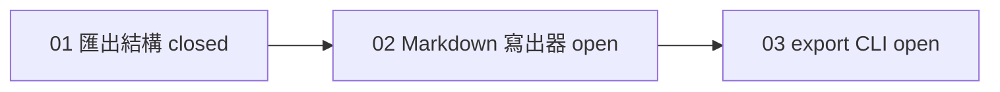

## 工具呼叫

- Skill {"skill": "pm"}
- Read {"file_path": "/private/var/folders/mp/2hbmdcp15qjfn3fhgctttgl40000gn/T/tmp.Tc3MzrJ7vB/.claude/skills/pm/references/next-step.md"}
- Glob {"pattern": ".scratch/notes/**", "path": "/private/var/folders/mp/2hbmdcp15qjfn3fhgctttgl40000gn/T/tmp.Tc3MzrJ7vB"}
- Read {"file_path": "/private/var/folders/mp/2hbmdcp15qjfn3fhgctttgl40000gn/T/tmp.Tc3MzrJ7vB/docs/workflow/build-ticket.md"}
- Read {"file_path": "/private/var/folders/mp/2hbmdcp15qjfn3fhgctttgl40000gn/T/tmp.Tc3MzrJ7vB/.scratch/notes/spec.md"}
- Read {"file_path": "/private/var/folders/mp/2hbmdcp15qjfn3fhgctttgl40000gn/T/tmp.Tc3MzrJ7vB/.scratch/notes/issues/01-export-schema.md"}
- Read {"file_path": "/private/var/folders/mp/2hbmdcp15qjfn3fhgctttgl40000gn/T/tmp.Tc3MzrJ7vB/.scratch/notes/issues/02-markdown-writer.md"}
- Read {"file_path": "/private/var/folders/mp/2hbmdcp15qjfn3fhgctttgl40000gn/T/tmp.Tc3MzrJ7vB/.scratch/notes/issues/03-export-cli.md"}
- Read {"file_path": "/private/var/folders/mp/2hbmdcp15qjfn3fhgctttgl40000gn/T/tmp.Tc3MzrJ7vB/.claude/skills/pm/references/check.md"}

## 最終回覆

**建議下一張:工單 02「Markdown 寫出器」**

資料來源是 `.scratch/notes/` 的本機檔案,我在 2026-10-22 讀取。本機沒有 git,我也沒有查 GitHub,所以 PR 狀態沒有查證。

## 進度
整個計畫共 3 張工單,1 張已關閉,完成 1/3。這個比例只算張數,不代表功能完成度。

| 工單 | 狀態 | 阻擋 | 判定 |
| --- | --- | --- | --- |
| 01 | closed | 無 | 完成。工單寫 PR #11 已合併至 main,這是**推論**:我只看到工單文字,沒有查 PR。 |
| 02 | open,無人認領 | 01 | **可開始**,因為 01 已完成(推論,見上)。 |
| 03 | open,無人認領 | 02 | 等待 02 完成。 |

02 是唯一可開始的工單,也是唯一的前沿,所以沒有取捨問題。

## 交接(可貼到新 session)
- **工單**:`.scratch/notes/issues/02-markdown-writer.md`,屬於 `.scratch/notes/spec.md`「Notes 匯出功能」。
- **範圍**:把匯出 JSON 結構轉成 Markdown 檔。
- **邊界**:不做 `inkwell export` 指令,那是 03。
- **前置**:01 已關閉,匯出 JSON 結構定義在 PR #11。開工前先確認 #11 確實合併到 main。
- **驗收**:單元測試涵蓋標題、清單、程式碼區塊。
- **認領與分支**:目前無人認領,我也沒有查到既有分支。
- **交付終點**:PR 合併至 main。
- **入口**:專案規則 `AGENTS.md` 指定 `docs/workflow/build-ticket.md`。它一次做一張工單,開分支、測試先行、開 PR,並要求工單已有範圍與驗收。02 符合這兩點。
- **授權**:只涵蓋 02 這一張。commit、push、merge 要另外取得你的授權(`AGENTS.md`)。
- **第一步**:讀 PR #11 定義的匯出結構,先為標題、清單、程式碼區塊各寫一個失敗測試,再實作。
- **完成後**:回報結果,並建議 03 作為下一張,不會自動開始 03。

## 下一步
我沒有寫任何檔案,也沒有開始執行。在新 session 回覆「執行這張」,就會用 `build-ticket` 處理 02。如果你想把這份交接存成檔案,請告訴我路徑。
