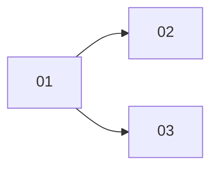

## 工具呼叫

- Skill {"skill": "pm"}
- Read {"file_path": "/private/var/folders/mp/2hbmdcp15qjfn3fhgctttgl40000gn/T/tmp.zb5UsvPOds/.claude/skills/pm/references/check.md"}
- Read {"file_path": "/private/var/folders/mp/2hbmdcp15qjfn3fhgctttgl40000gn/T/tmp.zb5UsvPOds/.claude/skills/pm/references/plan.md"}
- Glob {"pattern": ".scratch/**/*", "path": "/private/var/folders/mp/2hbmdcp15qjfn3fhgctttgl40000gn/T/tmp.zb5UsvPOds"}
- Read {"file_path": "/private/var/folders/mp/2hbmdcp15qjfn3fhgctttgl40000gn/T/tmp.zb5UsvPOds/.scratch/notes/spec.md"}
- Read {"file_path": "/private/var/folders/mp/2hbmdcp15qjfn3fhgctttgl40000gn/T/tmp.zb5UsvPOds/.scratch/notes/issues/01-export-schema.md"}
- Read {"file_path": "/private/var/folders/mp/2hbmdcp15qjfn3fhgctttgl40000gn/T/tmp.zb5UsvPOds/.scratch/notes/issues/02-markdown-writer.md"}
- Read {"file_path": "/private/var/folders/mp/2hbmdcp15qjfn3fhgctttgl40000gn/T/tmp.zb5UsvPOds/.scratch/notes/issues/03-html-writer.md"}
- Read {"file_path": "/private/var/folders/mp/2hbmdcp15qjfn3fhgctttgl40000gn/T/tmp.zb5UsvPOds/.claude/skills/pm/references/next-step.md"}
- Read {"file_path": "/private/var/folders/mp/2hbmdcp15qjfn3fhgctttgl40000gn/T/tmp.zb5UsvPOds/docs/workflow/build-ticket.md"}

## 最終回覆

**結論:`02` 和 `03` 在依賴上可以同時做,但實際上不建議同時做。** 兩張都改 `src/export.ts`,而且都指派給 alice。

資料來源是 `.scratch/notes/` 的 spec 和三張工單檔,2026-10-22 讀取(時區未取得)。我沒有 git 或 `gh` 可查,PR #11 只有工單自己的記載,我沒能核對。

## 進度
- 範圍是 3 張工單,沒有取消或範圍外的項目。目前 1/3 已關閉,這個比例只算張數,不代表功能完成度。
- **01 匯出資料結構**:State 是 closed,驗收寫「PR #11 已合併至 main」。這是工單自己的記載,屬 **inferred**。
- **02 Markdown 寫出器**:open,被 01 擋住,指派 alice,驗收尚未完成。
- **03 HTML 寫出器**:open,被 01 擋住,指派 alice,驗收尚未完成。
- 01 已關閉,所以 02 和 03 都在可開工的範圍內,而且都還沒開始。
- 依賴關係:`01 → 02`、`01 → 03`。

## 02 和 03 可以同時做嗎
- **依賴上:可以。** 02 和 03 之間沒有依賴,前置的 01 也已關閉。
- **實際上:工單記載了兩個限制,所以我不說它們能真正平行。**
  - **同一檔案**:兩張的 `Files` 都是 `src/export.ts`,同時改容易衝突。
  - **同一個人**:兩張都指派 alice,她同一時間只能專心做一張。
- **建議**:依計畫順序先做 02,再做 03。要平行的話,得先決定兩個寫出器怎麼分檔,或改派人。這由你決定,我不改工單。

## 需要你留意的事
- **spec 與工單的範圍不一致**:spec 的目標是「匯出為 Markdown 檔」,但 03 是 HTML 寫出器,spec 沒提到 HTML。這是範圍問題,請確認 03 是否在範圍內。
- **缺資料**:工單沒有里程碑、工期或成本,所以我不估完成日,也不算關鍵路徑。有這些資料再補算。

## 下一步提案
- **建議先做 02**
  - **進入點**:`docs/workflow/build-ticket.md`,來源是 AGENTS.md 的專案規則。我讀了它:一次一張工單、開分支、測試先行、開 PR。02 有範圍和驗收,符合它接受的條件。
  - **範圍**:只做 02,驗收是單元測試涵蓋標題、清單、程式碼區塊。
  - **交付終點**:PR 合併至 main。合併要先取得你的授權。
- 你回覆「執行這張」我才會開始。這次是唯讀模擬,所以我現在先停下,沒有改檔、開分支或 commit。
