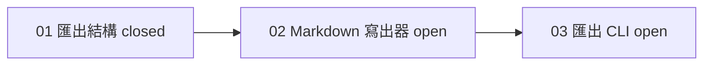

## 工具呼叫

- Skill {"skill": "pm"}
- Read {"file_path": "/private/var/folders/mp/2hbmdcp15qjfn3fhgctttgl40000gn/T/tmp.jH3OaYIfkP/.claude/skills/pm/references/next-step.md"}
- Glob {"pattern": ".scratch/notes/**", "path": "/private/var/folders/mp/2hbmdcp15qjfn3fhgctttgl40000gn/T/tmp.jH3OaYIfkP"}
- Read {"file_path": "/private/var/folders/mp/2hbmdcp15qjfn3fhgctttgl40000gn/T/tmp.jH3OaYIfkP/docs/workflow/build-ticket.md"}
- Read {"file_path": "/private/var/folders/mp/2hbmdcp15qjfn3fhgctttgl40000gn/T/tmp.jH3OaYIfkP/.scratch/notes/spec.md"}
- Read {"file_path": "/private/var/folders/mp/2hbmdcp15qjfn3fhgctttgl40000gn/T/tmp.jH3OaYIfkP/.scratch/notes/issues/01-export-schema.md"}
- Read {"file_path": "/private/var/folders/mp/2hbmdcp15qjfn3fhgctttgl40000gn/T/tmp.jH3OaYIfkP/.scratch/notes/issues/02-markdown-writer.md"}
- Read {"file_path": "/private/var/folders/mp/2hbmdcp15qjfn3fhgctttgl40000gn/T/tmp.jH3OaYIfkP/.scratch/notes/issues/03-export-cli.md"}
- Read {"file_path": "/private/var/folders/mp/2hbmdcp15qjfn3fhgctttgl40000gn/T/tmp.jH3OaYIfkP/.claude/skills/pm/references/check.md"}

## 最終回覆

# 下一步:做 02「Markdown 寫出器」

**查詢來源**:本機 `.scratch/notes/`(spec.md 和 issues/01–03),讀取時間為 2026-10-22,時間未知。這裡不是 git 倉庫,也沒有 `gh`,所以我無法查 PR 的實際狀態。

## 進度
已完成 1 張,共 3 張(以 `.scratch/notes` 內 3 張工單為分母,沒有取消或範圍外的工單)。

| 工單 | 狀態 | 判斷 |
| --- | --- | --- |
| 01 | closed | 驗收註明 PR #11 已合併至 main。這是**推論**,因為我只看到工單文字,無法查 PR 本身。 |
| 02 | open,Blocked by 01,無 assignee | **可開工**。前置 01 已 closed,且沒有人認領。 |
| 03 | open,Blocked by 02 | 等待 02,現在不能開工。 |

這是一條線性鏈,沒有可平行的工作,所以 02 是唯一的選擇。

## 交接內容(可貼到新 session)
- **工單**:`.scratch/notes/issues/02-markdown-writer.md`(02:Markdown 寫出器)。
- **目的與範圍**:把 01 定義的匯出 JSON 結構轉成 Markdown 檔。
- **邊界**:不做 `inkwell export` 指令,那是 03 的範圍。
- **前置與阻塞**:01 已 closed,目前沒有阻塞。建議開工前先確認 PR #11 確實已合併到 main,因為我只能從工單文字推論。
- **分支與認領**:Assignee 是 none,沒有看到既有分支。
- **閱讀入口**:`.scratch/notes/spec.md`(目標與交付終點)和 01 工單(匯出結構的定義)。
- **驗收**:單元測試涵蓋標題、清單、程式碼區塊。
- **交付終點**:PR 合併至 main。
- **第一步**:讀 01 定義的 JSON 結構,先寫標題、清單、程式碼區塊的失敗測試,再實作。
- **授權**:只授權這一張。commit、push、merge 要先取得你的授權(依 AGENTS.md)。

## 進入點
- **來源**:專案規則。AGENTS.md 指定「實作工單」依 `docs/workflow/build-ticket.md`。
- **內容**:一次實作一張工單,開分支、測試先行、開 PR。只接受已有範圍與驗收的工單。02 有範圍也有驗收,符合條件。
- **接受單位**:一次一張,所以只交接 02,不把整份 spec 交出去。

## 接下來
- 我不會在這次做任何執行,也沒有改動任何檔案或建立交接檔。上面的交接內容留在對話裡,供你貼到新 session。
- 在新 session 回覆「執行這張」,就會依 `build-ticket.md` 開始做 02。
- 如果你要把交接寫進某個檔案,告訴我路徑,我再寫。
- 02 完成後再評估 03,不會自動接著做。
