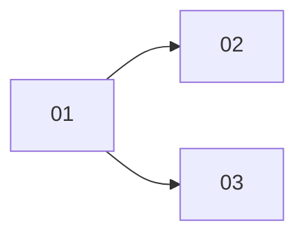

## 工具呼叫

- Skill {"skill": "pm"}
- Read {"file_path": "/private/var/folders/mp/2hbmdcp15qjfn3fhgctttgl40000gn/T/tmp.yeZylZwo5G/.claude/skills/pm/references/check.md"}
- Read {"file_path": "/private/var/folders/mp/2hbmdcp15qjfn3fhgctttgl40000gn/T/tmp.yeZylZwo5G/.claude/skills/pm/references/plan.md"}
- Glob {"pattern": "**/*", "path": "/private/var/folders/mp/2hbmdcp15qjfn3fhgctttgl40000gn/T/tmp.yeZylZwo5G/.scratch"}
- Glob {"pattern": "docs/**/*", "path": "/private/var/folders/mp/2hbmdcp15qjfn3fhgctttgl40000gn/T/tmp.yeZylZwo5G"}
- Read {"file_path": "/private/var/folders/mp/2hbmdcp15qjfn3fhgctttgl40000gn/T/tmp.yeZylZwo5G/.scratch/notes/spec.md"}
- Read {"file_path": "/private/var/folders/mp/2hbmdcp15qjfn3fhgctttgl40000gn/T/tmp.yeZylZwo5G/.scratch/notes/issues/01-export-schema.md"}
- Read {"file_path": "/private/var/folders/mp/2hbmdcp15qjfn3fhgctttgl40000gn/T/tmp.yeZylZwo5G/.scratch/notes/issues/02-markdown-writer.md"}
- Read {"file_path": "/private/var/folders/mp/2hbmdcp15qjfn3fhgctttgl40000gn/T/tmp.yeZylZwo5G/.scratch/notes/issues/03-html-writer.md"}
- Read {"file_path": "/private/var/folders/mp/2hbmdcp15qjfn3fhgctttgl40000gn/T/tmp.yeZylZwo5G/docs/workflow/build-ticket.md"}

## 最終回覆

**進度:3 張工單中 1 張已關閉(1/3,按工單數計,不代表功能完成比例)。02 和 03 在 DAG 上可以同時做,但實際上不能放心並行,因為兩張都指派給 alice,而且都改 `src/export.ts`。**

資料來源是 `.scratch/notes/spec.md` 和 `issues/01~03`,查詢時間未知(環境沒有時鐘)。這不是 git repo,我也沒查 PR 或 tracker。

| 工單 | 狀態 | Blocked by | Assignee | 判定 |
| --- | --- | --- | --- | --- |
| 01 匯出資料結構 | closed | none | – | 已完成。驗收項勾選,並寫著 PR #11 已合併至 main。這是工單自述,我沒有查 PR(證據不足以標為 verified,屬 inferred)。 |
| 02 Markdown 寫出器 | open | 01 | alice | 前置已滿足,可開工,但已有人認領。驗收尚未達成。 |
| 03 HTML 寫出器 | open | 01 | alice | 前置已滿足,可開工,但已有人認領。驗收尚未達成。 |

**02 和 03 能否並行**
- **依賴:** 兩者只依賴 01,彼此沒有依賴,所以 DAG 允許並行。
- **人員:** 兩張都指派給 alice,工單沒有記錄其他人可接手。
- **程式碼:** 兩張的 Files 欄都是 `src/export.ts`,同時修改很可能衝突(inferred,工單只列檔案,沒寫具體改動範圍)。
- **結論:** 有依賴上的並行空間,但人力和檔案重疊的限制都記錄在工單裡。要並行,得先改派其中一張,或約定在 `src/export.ts` 內怎麼切分。建議由 alice 依序做完一張再做下一張,這是我的建議,不是記錄在案的規定。

**需要你決定的缺口**
- **範圍不一致:** spec 的目標只寫「匯出為 Markdown 檔」,沒有提到 HTML。03 看起來超出 spec 範圍。請確認是要把 HTML 補進 spec,還是把 03 移出本計畫。
- **缺少資訊:** 沒有里程碑、工期或成本記錄,所以我不估完成日期,也不算關鍵路徑。

**下一步**
- 專案規則 `AGENTS.md` 指定的入口是 `docs/workflow/build-ticket.md`,它一次實作一張工單,只收已有範圍與驗收的工單,所以 02 和 03 都符合收件條件。
- 建議先做 02,因為它對應 spec 的核心目標。
- 你選定後,我會用 build-ticket 流程接手 02:開分支、測試先行、開 PR。
- 這次是唯讀模擬,我先停在這裡,沒有領取工單、改檔案或做任何 Git 操作。
