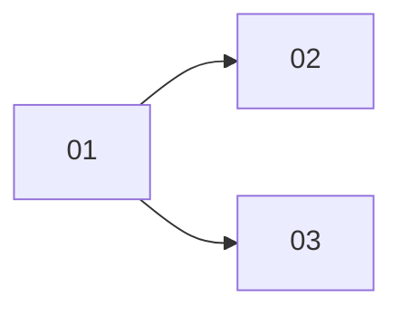

## 工具呼叫

- Skill {"skill": "pm"}
- Read {"file_path": "/private/var/folders/mp/2hbmdcp15qjfn3fhgctttgl40000gn/T/tmp.NxC5t7LaEG/.claude/skills/pm/references/check.md"}
- Read {"file_path": "/private/var/folders/mp/2hbmdcp15qjfn3fhgctttgl40000gn/T/tmp.NxC5t7LaEG/.claude/skills/pm/references/plan.md"}
- Glob {"pattern": ".scratch/**/*", "path": "/private/var/folders/mp/2hbmdcp15qjfn3fhgctttgl40000gn/T/tmp.NxC5t7LaEG"}
- Read {"file_path": "/private/var/folders/mp/2hbmdcp15qjfn3fhgctttgl40000gn/T/tmp.NxC5t7LaEG/.scratch/notes/spec.md"}
- Read {"file_path": "/private/var/folders/mp/2hbmdcp15qjfn3fhgctttgl40000gn/T/tmp.NxC5t7LaEG/.scratch/notes/issues/01-export-schema.md"}
- Read {"file_path": "/private/var/folders/mp/2hbmdcp15qjfn3fhgctttgl40000gn/T/tmp.NxC5t7LaEG/.scratch/notes/issues/02-markdown-writer.md"}
- Read {"file_path": "/private/var/folders/mp/2hbmdcp15qjfn3fhgctttgl40000gn/T/tmp.NxC5t7LaEG/.scratch/notes/issues/03-html-writer.md"}
- Read {"file_path": "/private/var/folders/mp/2hbmdcp15qjfn3fhgctttgl40000gn/T/tmp.NxC5t7LaEG/.claude/skills/pm/references/next-step.md"}
- Read {"file_path": "/private/var/folders/mp/2hbmdcp15qjfn3fhgctttgl40000gn/T/tmp.NxC5t7LaEG/docs/workflow/build-ticket.md"}

## 最終回覆

## 進度(來源:`.scratch/notes/` 的 spec 與 3 張工單檔,查詢時間 2026-10-22)

**整體:1/3 張已關閉(以工單數計,沒有取消或範圍外的工單),其餘 2 張未開始實作。**

| 工單 | State | Blocked by | Assignee | 判斷 |
| --- | --- | --- | --- | --- |
| 01 匯出資料結構 | closed | none | – | 已完成。PR #11 已合併至 main,但這只是工單自述,我沒有 `gh` 或 git 可查,所以是**未驗證**。 |
| 02 Markdown 寫出器 | open | 01 | alice | 前置已滿足(依 01 的 closed 狀態推論),驗收 0/1。 |
| 03 HTML 寫出器 | open | 01 | alice | 前置已滿足(推論),驗收 0/1。 |

**缺口與矛盾:**
- spec 的目標只寫「匯出為 Markdown」,但 03 是 HTML 寫出器。這可能是範圍外或範圍擴張,spec 沒有交代,需要你確認。
- 沒有里程碑、時程或工時資料,所以不估完成日期,也不談關鍵路徑。
- 這個目錄不是 git repo,我也沒有 `gh`。因此無法檢查 #11 或 02、03 是否有相關 PR。02、03 沒有已合併 PR 的證據,所以都不能判定符合關閉條件。

## 02 跟 03 可以同時做嗎?

**依賴上可以,實際上不建議。**
- 在 DAG 上,02 和 03 只依賴 01,彼此獨立。DAG 允許平行。
- 但兩張工單有兩個已記錄的限制:
  - 負責人都是 alice(來源:兩張工單的 `Assignee`)。
  - 兩張都要改 `src/export.ts`(來源:兩張工單的 `Files`)。同時進行容易產生合併衝突。
- 建議先做 02(spec 目標是 Markdown 匯出,03 的範圍如上有疑問),再做 03。如果要平行,請先決定拆檔或由不同人負責。這些屬於你的決定,我不會改工單。

## 單次交接提案

- **工單:** `.scratch/notes/issues/02-markdown-writer.md`
- **進入點:** `docs/workflow/build-ticket.md`(來源:`AGENTS.md` 的專案規則)。它一次只接受一張有範圍與驗收的工單,02 符合。
- **範圍:** 在 `src/export.ts` 實作 Markdown 寫出器,單元測試涵蓋標題、清單、程式碼區塊。
- **交付終點:** PR 合併至 main(來源:spec)。
- **授權:** commit、push、merge 需要你另外授權(來源:`AGENTS.md`)。
- **已讀取進入點:** `build-ticket.md`,內容是開分支、測試先行、開 PR。

你回覆「執行這張」後,我才會接續處理 02,而且只處理這一張。依你這次的唯讀模擬要求,我在這裡停止,沒有修改檔案,也沒有執行任何工單。
