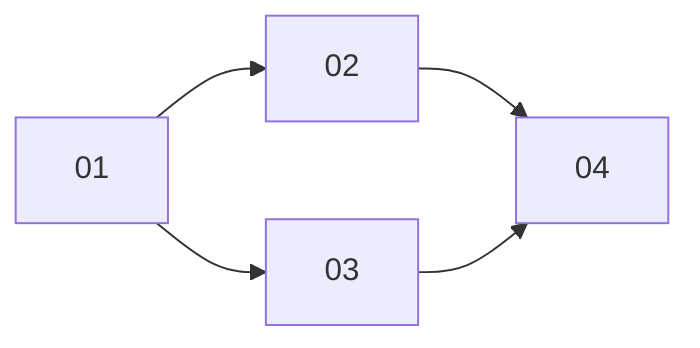

## 工具呼叫

- Skill {"skill": "pm", "args": "看一下 .scratch/ledger 的進度"}
- Read {"file_path": "/private/var/folders/mp/2hbmdcp15qjfn3fhgctttgl40000gn/T/tmp.aTiRdESl2T/.claude/skills/pm/references/check.md"}
- Glob {"pattern": ".scratch/ledger/**", "path": "/private/var/folders/mp/2hbmdcp15qjfn3fhgctttgl40000gn/T/tmp.aTiRdESl2T"}
- Glob {"pattern": "docs/**/*.md", "path": "/private/var/folders/mp/2hbmdcp15qjfn3fhgctttgl40000gn/T/tmp.aTiRdESl2T"}
- Read {"file_path": "/private/var/folders/mp/2hbmdcp15qjfn3fhgctttgl40000gn/T/tmp.aTiRdESl2T/.scratch/ledger/spec.md"}
- Read {"file_path": "/private/var/folders/mp/2hbmdcp15qjfn3fhgctttgl40000gn/T/tmp.aTiRdESl2T/.scratch/ledger/issues/01-csv-schema.md"}
- Read {"file_path": "/private/var/folders/mp/2hbmdcp15qjfn3fhgctttgl40000gn/T/tmp.aTiRdESl2T/.scratch/ledger/issues/02-csv-parser.md"}
- Read {"file_path": "/private/var/folders/mp/2hbmdcp15qjfn3fhgctttgl40000gn/T/tmp.aTiRdESl2T/.scratch/ledger/issues/03-category-rules.md"}
- Read {"file_path": "/private/var/folders/mp/2hbmdcp15qjfn3fhgctttgl40000gn/T/tmp.aTiRdESl2T/.scratch/ledger/issues/04-monthly-report.md"}
- Read {"file_path": "/private/var/folders/mp/2hbmdcp15qjfn3fhgctttgl40000gn/T/tmp.aTiRdESl2T/docs/workflow/build-ticket.md"}

## 最終回覆

**進度總覽:4 張工單中 1 張已關閉(25%)。** 分母是 `.scratch/ledger/issues/` 的 4 張,沒有取消或範圍外的工單。這個比例只算張數,不代表功能完成度。

資料來源是 `.scratch/ledger/spec.md` 和 `issues/01~04`。查詢時間未知,環境沒有提供時鐘。這裡不是 git repo,也沒有 `gh`,所以我沒辦法查 PR 狀態。

| 工單 | State | Blocked by | 狀態判斷 |
| --- | --- | --- | --- |
| 01 CSV 欄位定義 | closed | none | 已完成。驗收項目已勾選,並註記 PR #21 已合併至 main。 |
| 02 CSV 解析器 | open | 01 | 就緒。前置工單 01 已關閉,尚未開始。 |
| 03 分類規則 | open | 01 | 就緒。前置工單 01 已關閉,尚未開始。 |
| 04 月報 | open | 02, 03 | 等待 02 和 03 完成。 |

**證據**
- **01 已完成(只有工單紀錄,未獨立驗證):** 工單寫了 PR #21 已合併,但我無法確認 PR 是否存在、合併目標是否為 main,以及 `src/schema.ts` 是否真的在 main 上。因為 02 和 03 都依賴 01,建議之後用 `gh pr view 21` 確認一次。
- **依賴關係:** 全部取自工單的 `Blocked by` 欄位,沒有缺漏的節點,也沒有循環或矛盾的狀態。
- **收尾驗證:** 其他 3 張工單沒有 PR 紀錄可查,所以沒有可評估的關閉候選。

**下一步建議**
- 02 和 03 目前都是就緒狀態。兩者的依賴相同,改動檔案也不同(`src/parser.ts` 和 `src/categories.ts`),從工單內容看可以分開做。
- 我沒有核對計畫的平行規則,也不知道是否有人已認領,所以不把「可平行」當成定論。
- 04 要等 02 和 03 都合併後才能開始。
- 專案進入點是 `docs/workflow/build-ticket.md`,由 `AGENTS.md` 指定,一次實作一張工單。因此交接會一次一張,例如先交 02,再交 03。

這次只做了唯讀查詢,沒有修改任何檔案或工單。你選好要先做哪一張後,我會先讀 `build-ticket.md` 的要求,再交接給它,並依 `AGENTS.md` 在你授權的範圍內處理分支與 commit。
