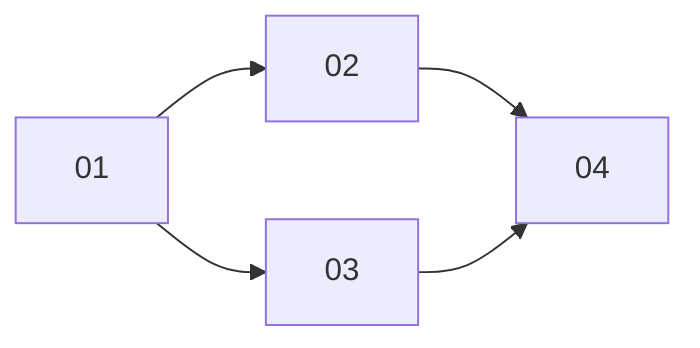

## 工具呼叫

- Skill {"skill": "pm", "args": "看一下 .scratch/ledger 的進度"}
- Read {"file_path": "/private/var/folders/mp/2hbmdcp15qjfn3fhgctttgl40000gn/T/tmp.jn1c6i8WvE/.claude/skills/pm/references/check.md"}
- Glob {"pattern": "**/*", "path": "/private/var/folders/mp/2hbmdcp15qjfn3fhgctttgl40000gn/T/tmp.jn1c6i8WvE/.scratch"}
- Read {"file_path": "/private/var/folders/mp/2hbmdcp15qjfn3fhgctttgl40000gn/T/tmp.jn1c6i8WvE/.scratch/ledger/spec.md"}
- Read {"file_path": "/private/var/folders/mp/2hbmdcp15qjfn3fhgctttgl40000gn/T/tmp.jn1c6i8WvE/.scratch/ledger/issues/01-csv-schema.md"}
- Read {"file_path": "/private/var/folders/mp/2hbmdcp15qjfn3fhgctttgl40000gn/T/tmp.jn1c6i8WvE/.scratch/ledger/issues/02-csv-parser.md"}
- Read {"file_path": "/private/var/folders/mp/2hbmdcp15qjfn3fhgctttgl40000gn/T/tmp.jn1c6i8WvE/.scratch/ledger/issues/03-category-rules.md"}
- Read {"file_path": "/private/var/folders/mp/2hbmdcp15qjfn3fhgctttgl40000gn/T/tmp.jn1c6i8WvE/.scratch/ledger/issues/04-monthly-report.md"}
- Read {"file_path": "/private/var/folders/mp/2hbmdcp15qjfn3fhgctttgl40000gn/T/tmp.jn1c6i8WvE/docs/workflow/build-ticket.md"}

## 最終回覆

## tally 記帳匯入功能（`.scratch/ledger`）進度

**查詢來源與時間：** 本機檔案 `.scratch/ledger/spec.md` 和 `issues/01–04`，查詢日期 2026-11-21，時間未知。這個目錄不是 git repo，也沒有 `gh` 可查，所以 PR 與 main 的狀態我查不到。

**整體進度：1/4 張工單 closed（25%）。** 分母是 4 張，沒有 canceled 或範圍外的工單。這個比例只算張數，不代表功能完成度。

| 工單 | State | Blocked by | 分類 |
| --- | --- | --- | --- |
| 01 CSV 欄位定義 | closed | none | 已完成 |
| 02 CSV 解析器 | open | 01 | ready |
| 03 分類規則 | open | 01 | ready |
| 04 月報 | open | 02, 03 | 等前置工單 |

**Ready 的工單：** 02 和 03 都只依賴 01。兩張的變更檔案不同（`src/parser.ts` 和 `src/categories.ts`），彼此沒有宣告依賴，從檔案範圍看可以平行。這是**推論**，我沒有查它們是否共用其他程式碼。
- 工單上沒有 assignee 欄位，所以看不出有沒有人已經開工。

**驗證狀態：**
- 01 的驗收只寫「PR #21 已合併至 main」，這是工單自己的紀錄。因為沒有 repo 或 `gh` 可查，我無法確認 PR 真的合併了，所以只能算**假設**。
- 02、03、04 沒有 PR 或完成證據，驗收項目都還沒勾。
- 02 和 03 都以 01 為前置，所以 01 若沒有真的合併，這兩張就不算 ready。建議先確認 PR #21 的合併狀態。

**交付終點：** 要等 04 完成並合併到 main 才算完成，目前還沒到。

**建議下一步：** 先做 02（解析器）。它是 04 整合測試「從 CSV 到月報」的入口，拖延的話對 04 影響較大。03 可以同時做。

**進入點：** 專案規則 `AGENTS.md` 指定用 `docs/workflow/build-ticket.md` 實作工單，一次一張。它沒有宣告整份 spec 批次處理，所以我會一次交一張給它。

**接下來我會做的事：** 這次只是看進度，我沒有動手實作。如果你選好要做 02 還是 03，我會用 `build-ticket` 流程交接那一張，分支用 `feat/<slug>`。commit、push、merge 都要在你授權的範圍內才會做。現在我停在這裡。
